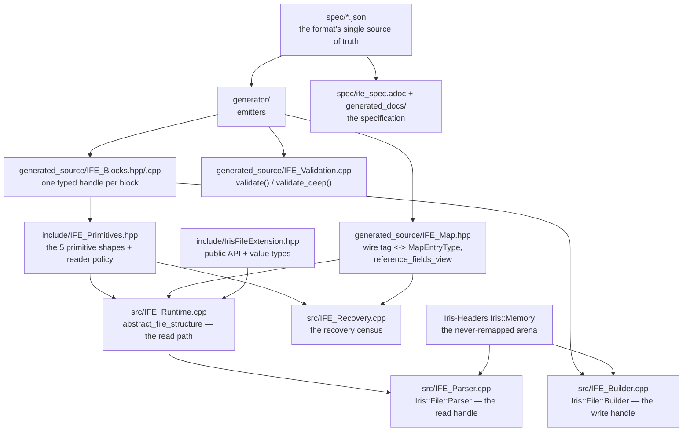
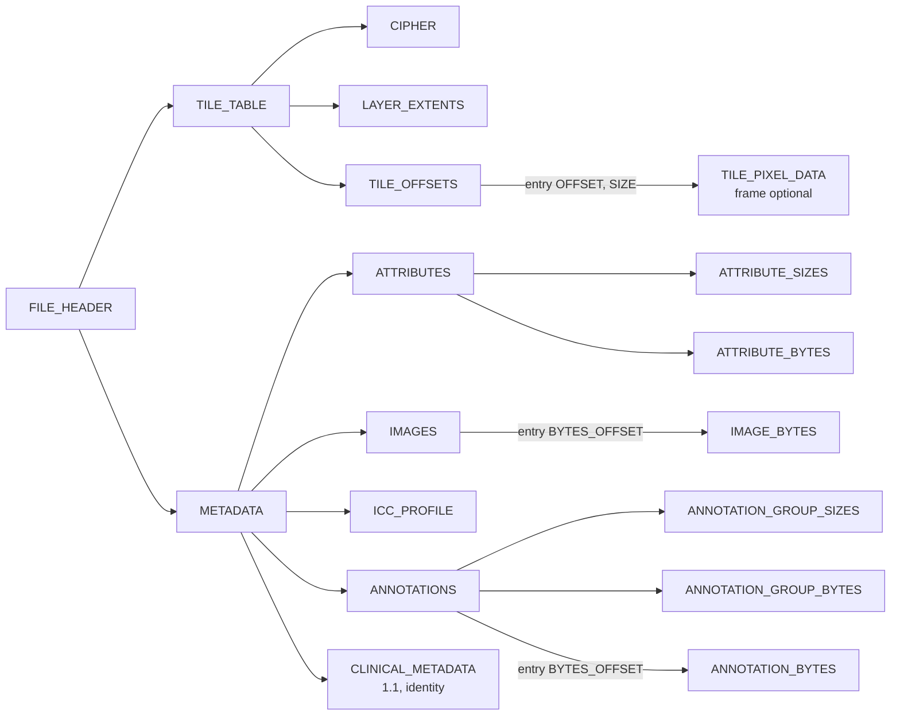
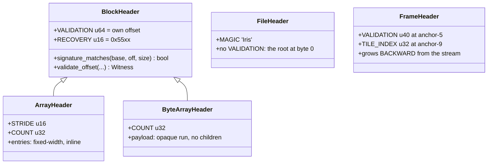
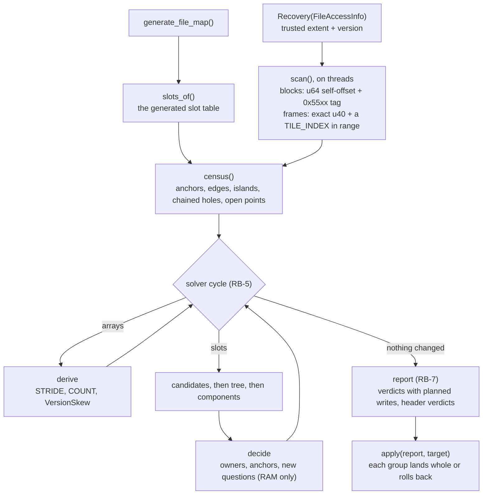

# ARCHITECTURE.md — Iris-File-Extension: layering, block governance and decisions

**Status:** the design contract of the Iris File Extension (IFE) library and
specification. A decision is changed only by a dated amendment in the row it
changes (§1). · **Date:** 2026-11-24 · **Owner:** the maintainer
(`.github/CODEOWNERS`)

IFE is the public specification of the Iris slide file format (`spec/*.json`
and `spec/ife_spec.adoc`) and the C++20 library generated from it that reads,
writes, validates and recovers those files. The *format* (every block, field,
offset and constant) is specified in `spec/` and is not restated here. This
document records the machinery around those bytes: which layer owns which
fact, who governs each block, and the decisions the code follows. The dated
records the decisions were taken from are in [analysis/](analysis/).

---

## 0. How to read this document

| Section | What it settles |
|---|---|
| §1 Decisions | the decisions the code and the specification follow, dated, and the ones still owed |
| §2 Layers | which layer owns which fact, the handles, and the split with an application (diagrams) |
| §3 Block governance | one row per block: shape, parent slot, writer, reader, identity class (diagram) |
| §4 The five primitives | the shapes every block instantiates (diagram) |
| §5 Recovery | the census that exists and the solver being rebuilt (diagram) |
| §6 Known gaps | behaviour that looks like a defect and is a recorded limit |

**Citations.** `spec/…`, `src/…`, `include/…` and `tests/…` are this
repository. A work item (`RB-5`, `RC-10.4`, `VL-1`) is a row of
[WBS.md](WBS.md); a requirement (`Wire_01`) is a row of [RTM.md](RTM.md).
*(to confirm)* marks a statement not checked against its source while this
document was written.

---

## 1. Decisions

Each decision is a requirement the code follows, with the date it was taken
and the record it comes from.

| # | Decision | Why | Date · record |
|---|---|---|---|
| D1 | **The JSON documents in `spec/` are the one source of every wire fact.** Offsets, sizes, recovery tags and enumeration values are derived by the stdlib-only generator (`python3 -m generator`) into `generated_source/` and `generated_docs/`, which are rebuilt at configure and never edited; a fix goes into `generator/emit/`. | A fact stated twice can disagree; the generator derives the layout so that parity with the shipped format is checked by a gate (`--check`) instead of maintained by hand. | 2026-08-06 · [migration phases](analysis/migration_phases_1_to_6.md), Phases 1–3 |
| D2 | **Append-only.** A fact already in a version group is never moved, resized, retyped, renamed or removed; additions arrive as new version groups, fields at a group's end, or new blocks with new recovery tags; retirement is a `deprecated` mark (`{version, reason}`). `tests/wire/witness.json` records every shipped fact, and `--validate` refuses a change that breaks it. | Every file written under an earlier revision stays readable by every later reader; the witness turns the rule into a gate. | 2026-08-18 · XP-1, [cross-pollination](analysis/cross_pollination_2026-08-18.md) |
| D3 | **Byte-for-byte parity with the shipped 1.0 format.** The schema describes the bytes 1.0 encoders wrote; 1.1 is additive (`TILE_LENGTH`, `Z_PLANES`, `MICRONS_PLANE`, tile frames' optional trailer, `CLINICAL_METADATA`). Real files exist, so a reader that disagrees with them is the defect. | Decisions 4.0-G and 4.0-H. | 2026-08-06 · [migration phases](analysis/migration_phases_1_to_6.md), §4.0 |
| D4 | **Little-endian on disk at every version, on every host.** File bytes are read and written only through `IFE_Bytes.hpp` or the generated handles. The `big-endian (s390x)` CI job runs the suite on a big-endian host under emulation. | A cast of a file pointer to a multi-byte type reads garbage on a big-endian host; the s390x job is the evidence. | 2026-11-24 · CI-2 |
| D5 | **IFE depends only on Iris-Headers.** Iris-Slide depends on IFE, and IFE on no consumer; IFE's handles are built first and the application is rewritten onto them. Generated types use Iris-Headers' vocabulary (`Iris::BYTE`, `Result`, `Iris::Memory`). | A format library that depends on its codec cannot be implemented independently. | 2026-08-06 (4.0-C), 2026-09-28 · [handle layer](analysis/handle_layer_2026-09-28.md) |
| D6 | **An application owns an IFE handle.** Iris-Slide's encoder holds an `Iris::File::Builder`, its slide reader an `Iris::File::Parser`. The Builder claims space and writes every block; the application does sources, codecs, threads, file names and moving files. | §2 states the split; each fact has one owner. | 2026-09-28 · [handle layer](analysis/handle_layer_2026-09-28.md) |
| D7 | **The layout belongs to the caller of the Builder.** `finalize` only seals (`BuilderFinalizeInfo{tileTable, metadata, revision}`); the caller composes every structure block through `claim` / `fill` / `append`, each landing at the head when called. Nothing is sorted. | The first `finalize` imposed its own order and Iris-Codec could no longer write the layout it had always written (tiles → tile table → METADATA → ICC → images → attributes). | 2026-09-30 · [handle layer](analysis/handle_layer_2026-09-28.md) |
| D8 | **Arenas never remap.** A Builder reserves a sparse range (8 GiB by default); growth is pages touched inside it; exhausting it is terminal. On Windows each claim commits its range first. | A fixed base lets `append_tile` claim space lock-free from many threads. | 2026-09-28 |
| D9 | **NULL_TILE is a legitimate "no tile here".** A Builder refuses to finalize a tile nobody accounted for, and never publishes one as NULL_TILE. | An unaccounted tile is a writer defect; publishing it as absent would hide the defect in the file. | 2026-09-28 |
| D10 | **Tile frames** are optional on single-plane layers and required on every stream of a Z-stacked layer (1.1 draft, no version bump). The Builder frames every tile by default. | `TILE_INDEX` in the frame is the only identity witness a tile stream has (§5). | 2026-09-28 |
| D11 | **Namespaces.** IFE is `Iris::File::`; Iris-Headers' core stays `Iris::`. The `IFE_` prefixes (`IFE_EXPORT`, `IFE_*.hpp`) name the product and stay. `Iris::File` does not re-export `Iris::`. | Renamed from `IFE::` before that spelling was pushed. `Iris::Codec::` waits until the format vocabulary Iris-Headers declares in `namespace IrisSlide` moves to `Iris::`/`Iris::File::`, since renaming it in place would make File depend on the codec. | 2026-09-28 |
| D12 | **The read path refuses damaged files; it never repairs.** A generated handle's `operator bool` is `validate()` passing (both witnesses and every declared extent); `in_bounds()` is for code that reads damaged files on purpose (recovery, `generate_file_map`). Optional slots go through `present()`. | One flipped bit in an `ICC_PROFILE` COUNT made `abstract_file_structure()` read 1 GB past an 832-byte file; the bound `validate()` had was never called on the read path. | 2026-09-09 · RC-10.1 |
| D13 | **Recovery is rebuilt on FastFHIR's census → branch solver → transactional apply.** Eight rules carry over: nothing is written until the end; a proposed value is never evidence; each witness is compared with the value it should encode; hard constraints eliminate, everything else ranks; a match is admitted only where coincidence is improbable; the unit of decision is a branch; zero wrong writes; the result is deterministic. Density is not a rule (OD-R2, closed): exact adjacency is used only after a predecessor whose extent is exact. | The removed engine's lessons (RC-1 to RC-10) reappear as tests of the census engine. | 2026-09-28 · [recovery rebuild](analysis/recovery_rebuild_2026-09-28.md) |
| D14 | **The read path is a const lens over resident memory.** Read-path metadata and entry access are `std::span<const T>` over static (generated) or in-place (block) storage; no `std::vector` is built per call. Builder-side vectors that own data being written are allowed. Measure reads against a Release build. | FastFHIR's same change cut a call from 856 µs to 36 µs at `-O3`; the read path is documented allocation-free. | 2026-08-19 · [zero-copy](analysis/zero_copy_read_path_2026-08-19.md), ZC-1 to ZC-5 |
| D15 | **The release is gated on the corpus harness**, with full block coverage growing after the tag. Bindings follow the tag: Python first, then JavaScript/WebAssembly. The 1.1 `ATTRIBUTE_SIZE` 6→7 correction stays out of the published document; `tests/wire/README.md` is its record. | Holding the tag for full coverage would hold it indefinitely; the harness keeps coverage claims honest. | 2026-08-18 · [release work orders](analysis/release_work_orders_2026-08-18.md) |
| D16 | **No binary blobs in the repository.** Conformance fixtures are hosted (`iris.exampleslides.org`), pinned by SHA-256 in the committed `tests/corpus/manifest.json`, fetched at configure into `.deps/corpus/`, and a fetch failure fails the configure loudly. | A digest makes a hosted corpus reproducible; a skipped corpus test would narrow the gate silently. | 2026-08-12 · Phase 6 |
| D17 | **`METADATA_FREE_TEXT` and `METADATA_I2S` are told apart by the attributes' version.** Free text carries version zero; I2S a nonzero I2S version; an unversioned I2S claim is free text. The schema gives `METADATA_FREE_TEXT` the value 3, with an errata on the member. | 1.0 aliased both to 1, and two conformance claims sharing a value cannot be distinguished. | 2026-08-18 · Phase 6 |
| D18 | **Patient identity is carried only by the clinical stream (`CLINICAL_METADATA`).** `METADATA_I2S` attributes are acquisition facts that identify no individual; `Builder::append_clinical` writes the file's one clinical stream and METADATA names it. | Removing one block then de-identifies a file (`spec/ife_constants.json`, `metadata_formats`). | 2026-11-24 · [b413498](https://github.com/Aptix-Bio/Iris-File-Extension/commit/b413498c959ca30e8a9aac626e13029812a57d3e) |
| D19 | **`IMAGE_ENCODING_PNG` and `ANNOTATION_PNG` are deprecated at 1.1.** The values stay assigned and are never reused; a file that carries one still reads; the Builder refuses them by name through the generated `deprecated_since`. | No writer emits PNG and the open decoder drops it; append-only (D2) retires a value instead of removing it. | 2026-11-24 · [4556534](https://github.com/Aptix-Bio/Iris-File-Extension/commit/45565345674089be95b6277f4c3c9733b408c527) |
| D20 | **The validation layer's diagnostic sink becomes a parallel log** that writer threads append to concurrently, each claiming its range by compare-and-swap, with an atomic failure counter beside it. | The caller-owned `std::string*` sink is a data race under a multithreaded writer, and IFE writes with multiple threads. | 2026-09-15 · VL-1, [analysis](analysis/validation_sink_race_2026-09-15.md) |
| D21 | **Warnings on and non-fatal; `-Wswitch` over every enumeration switch.** `-Wall -Wextra -Wswitch` (`/W4` on MSVC) in both build systems; no `-Werror`, so a compiler upgrade cannot break the build. A `switch` over an enumeration has no `default:`, so a new enumerator fails at compile time. | A gap class assigned and counted by nobody was FastFHIR's defect of this shape. | 2026-09-09 · RC-10.5 |
| D22 | **The open-source library formerly named Iris-Codec is Iris-Slide**; its namespace is `IrisSlide` and IFE's entry point `is_iris_slide_file`. Dated records keep the old name. | Rename of the consumer, 2026-11-24. | 2026-11-24 |
| D23 | **CI runs on Blacksmith runners**, with labels checked by `tools/runner_labels_lint.py`; workflows stay simple and their steps call CMake. | GitHub-hosted jobs in the organization's private repositories stopped starting over billing on that date; one runner family for every repository. | 2026-11-24 · CI-1, [analysis](analysis/blacksmith_ci_and_review_bot_2026-11-24.md) |
| D24 | **Every pull request from a branch of this repository is reviewed by the Aptix review bot** against `.github/review/rubric.toml`, which the bot reads with its reference files and CODEOWNERS from the default branch. | A pull request cannot change the rules it is judged by. | 2026-11-24 · CI-3 |
| D25 | **The plan lives in `development/`**: this document, [WBS.md](WBS.md), [RTM.md](RTM.md), [PIPELINE.md](PIPELINE.md) and [analysis/](analysis/). The root `MIGRATION.md`, `TASKS.md` and `architecture.md` were retired into them, with every work-item ID kept. | One layout across the Aptix repositories, and a reference set the review bot can send whole. | 2026-11-24 · CI-3.6 |

### 1.1 Decisions owed

Each has a default that lets work proceed; the maintainer decides.

| ID | Question | Default |
|---|---|---|
| OD-R1 | Where does recovery's `apply` write? FastFHIR copies the stream into a `std::vector`; a slide is gigabytes. | Into a writable mapping the caller supplies (a clone or copy of the file). Recovery never writes the source. |
| OD-R3 | One parent per block and per stream (H5). The spec does not forbid two tile entries sharing a stream, such as a deduplicated blank tile. | H5 is a hard constraint on the 16 declared edges and on tile entries, with a "shall not" for shared streams in the 1.1 draft. Nested attribute values are exempt: the format lets two share one structure (`test_shared_nested_structures_are_validated_once`). RB-0 found no sharing. |
| OD-R4 | `FILE_REVISION` implies in-place edits, which leave superseded blocks with valid witnesses. | Treat them as orphans; RB-5 adds a test that a superseded block is never attached. No writer edits in place today. |
| OD-R5 | Recovery's public shape. | FastFHIR's: `Recovery(const FileAccessInfo&)` with `census` / `recover` / `apply`, in `IFE_Recovery.hpp` (advanced tier). `RepairClass` becomes FastFHIR's seven. |

---

## 2. Layers

A field's offset exists in exactly one place, and every other place derives
from it.

A schema edit needs a `cmake .` before it reaches a build directory, since
generation runs at configure.

### Who owns which fact

| Fact | Owner | Never |
|---|---|---|
| a field's offset and width | `spec/*.json` → generated handle | a literal in hand-written code |
| what type a slot must point at | the parent's generated accessor, and `reference_fields_view` for code that walks the graph generically (both compiled from `points_to`) | read from the wire |
| a block's extent | the block's own `extent()` | fabricated, or taken from the arena's capacity |
| an array's element shape | the parent's compiled handle | derived from the array's wire tag |
| how many entries an array has | its stamped `COUNT`, bounded by arena geometry (`readable_entries`) | a walk that stops at the first invalid entry |
| whether a block is the one it claims to be | `validate()`, a handle's bool (D12) | an offset that merely lands in range |
| how to repair a damaged block | the recovery engine, being rebuilt (§5) | the read path, which refuses |
| how the stream is mutated: claims, bounds, fills, tile placements and frames | `Builder` | the application calling it |
| the layout: which block goes where, in what order | the application, through the order of its `append_*` / `claim` + `fill` calls (D7) | the `Builder` |
| the file's name, and moving it | the application | the `Builder` |

### The handles, and the split with an application

| Layer | Owns | Leaves to the other side |
|---|---|---|
| application (an encoder) | sources, compression, threads and which thread encodes which tile, progress, the layout, file names and moving files | claim arithmetic, bounds, `base + offset` writes, `store` / `size_of` |
| `Builder` | the reservation, byte-space claims and fills, every block write, the tile placements, tile frames, the completeness check, the header, a closed file at `finalize` | threads, scheduling, codecs, the layout, choosing or moving files |
| application (a slide reader) | decompression, pixel formats, output buffers | mapping the file, `base + offset` |
| `Parser` | the read-only mapping (owned via `Parser::open`), validation, the lifted structure, bounds-checked byte spans | decoding |

Writing to a temporary file and moving it into place is the application's
policy: it names the file, hands the path to `Builder::create`, and moves the
file once `finalize` returns. The Builder's contract is to leave the file
complete, truncated and closed. A new feature that decides *what or where*
belongs to the application; one that decides *how the bytes are laid down*
belongs to the Builder.

**The same verbs as FastFHIR.** The handles mirror FastFHIR's (`FF_Access.hpp`,
`FF_Builder.hpp` and its Python module), so a programmer who knows one reads
the other. IFE's Python bindings (R-4) follow FastFHIR's `ff.Memory` /
`ff.Builder` the same way.

| Concept | FastFHIR | IFE |
|---|---|---|
| make a writer | `FF_CreateBuilder({capacity, filepath, …})` | `Builder::create({capacity, filepath, tile_frames})` |
| write a block at the head, get its offset | `builder->append(T)` | `builder->append(XxxCreateInfo)`; `append_tile` / `append_image` / `append_clinical` for the streams |
| report what the writer placed | the offsets `append` returns | `tile_offsets()`, `image_entries()`; the caller composes TILE_OFFSETS and IMAGES from them |
| read the stream being built | `Builder_t::query()` → `Parser` | `query()` → `Parser` |
| reserve raw space | `claim_child_space(bytes)` | `builder->claim(bytes)` |
| write into space claimed earlier | `claim_child_space` + a four-argument `STORE_*` | `builder->fill(offset, XxxCreateInfo)` |
| name the root(s), then seal | `set_root(handle)`, then `finalize(algo)` | `finalize({tileTable, metadata, revision})`; the header has two roots |
| read | `Parser(buffer, size)`, `Parser(Memory)` | `Parser(FileAccessInfo)`, `Parser::open(path)` |

---

## 3. Block governance

**Who governs a block.** Every block's layout, offsets, enumerations and
conformance clauses are governed by `spec/ife_fields.json` and
`spec/ife_constants.json` under D2; a change to a block is a change to those
files, reviewed as a wire change (`--validate` against the witness, the witness
refreshed in the same pull request). A revision is ratified in
`spec/ife_header.json` with an ISO date (R-3.1), and `tools/release_guard.py`
refuses to release a draft. `.github/CODEOWNERS` gives `spec/` and the
generator to the maintainer. A block whose content another specification
defines says so in its `specified_by` key; IFE then governs only where the
bytes are and how many.

**Identity classes.** *none*: structural or numeric fields only. *rule: none*:
can hold free text, and D18 forbids identifying content; the writer controls
it and a reader cannot verify it. *pixels may identify*: an image whose
pixels can show identity (a slide label). *identity*: the block exists to
carry identity.

| Block | Shape (§4) | Since | Reached from | Content governed by | Written by | Read by | Identity |
|---|---|---|---|---|---|---|---|
| `FILE_HEADER` | FILE_HEADER, byte 0 | 1.0 | — (the root) | IFE | `finalize` | `Parser`, `is_iris_slide_file`, `validate_file_structure` | none |
| `TILE_TABLE` | BLOCK | 1.0 | `FILE_HEADER.TILE_TABLE_OFFSET` | IFE | `set_tile_table`, then `append`/`fill` | `Parser` | none |
| `CIPHER` | BLOCK, `reserved` | 1.0 | `TILE_TABLE.CIPHER_OFFSET` (NULL_OFFSET unless the encoding is `TILE_ENCODING_IRIS`) | reserved; meaning deferred | nothing writes it | the generated handle and validator | none |
| `LAYER_EXTENTS` | ARRAY | 1.0 | `TILE_TABLE.LAYER_EXTENTS_OFFSET` | IFE | `append`/`fill` from the tile table | `Parser` | none |
| `TILE_OFFSETS` | ARRAY | 1.0 | `TILE_TABLE.TILE_OFFSETS_OFFSET` | IFE | composed by the caller from `tile_offsets()` | `Parser::tile()` | none |
| `TILE_PIXEL_DATA` | TILE_FRAME (backward), optional | 1.0; frame trailer 1.1 | a `TILE_OFFSETS` entry (OFFSET, SIZE) | the tile encoding; IFE governs only the frame | `append_tile`, `append_null_tile` | `Parser::tile()`, `tile_planes()` | none *(inference: a tile holds compressed tissue pixels, and a label is an associated image)* |
| `METADATA` | BLOCK | 1.0 | `FILE_HEADER.METADATA_OFFSET` | IFE | `claim` early, `fill` last | `Parser` | none |
| `ATTRIBUTES` | BLOCK | 1.0 | `METADATA.ATTRIBUTES_OFFSET` | `metadata_formats`; I2S for `METADATA_I2S` | `append`/`fill` | `abstract_file_structure` | rule: none |
| `ATTRIBUTE_SIZES` | ARRAY | 1.0 | `ATTRIBUTES.SIZES_OFFSET` | IFE | from the caller's pairs | `abstract_file_structure` | none |
| `ATTRIBUTE_BYTES` | BYTE_ARRAY | 1.0 | `ATTRIBUTES.BYTES_OFFSET` | `metadata_formats` | from the caller's pairs | `abstract_file_structure` | rule: none |
| `IMAGES` | ARRAY | 1.0 | `METADATA.IMAGES_OFFSET` | IFE | composed from `image_entries()` | `Parser::image()` | none |
| `IMAGE_BYTES` | BLOCK | 1.0 | an `IMAGES` entry's `BYTES_OFFSET` | the image encoding | `append_image` | `Parser::image()` | pixels may identify (a label image) |
| `ICC_PROFILE` | BYTE_ARRAY, `external` | 1.0 | `METADATA.ICC_COLOR_OFFSET` | ICC.1 (International Color Consortium) | `append`/`fill` | `Parser` | none |
| `ANNOTATIONS` | ARRAY | 1.0 | `METADATA.ANNOTATIONS_OFFSET` | IFE | `append`/`fill` | `abstract_file_structure` | none |
| `ANNOTATION_BYTES` | BYTE_ARRAY, `external` | 1.0 | an `ANNOTATIONS` entry's `BYTES_OFFSET` | the entry's `annotation_types` value | `append`/`fill` | `abstract_file_structure` | rule: none |
| `ANNOTATION_GROUP_SIZES` | ARRAY | 1.0 | `ANNOTATIONS.GROUP_SIZES_OFFSET` | IFE | `append`/`fill` | `abstract_file_structure` | none |
| `ANNOTATION_GROUP_BYTES` | BYTE_ARRAY | 1.0 | `ANNOTATIONS.GROUP_BYTES_OFFSET` | IFE | `append`/`fill` | `abstract_file_structure` | rule: none |
| `CLINICAL_METADATA` | BYTE_ARRAY | 1.1 | `METADATA.CLINICAL_OFFSET` | `clinical_encodings`: HL7 v2, FHIR JSON, FastFHIR | `append_clinical`, one per file (D18) | `abstract_file_structure` | identity |

The 16 `points_to` edges (14 in block headers, 2 in array entries) are what
`reference_fields_view` and the census walk; the tile entry's u40 OFFSET and
nested attribute values are read by hand (RB-2).

---

## 4. The five primitives

Every block instantiates exactly one shape (`include/IFE_Primitives.hpp`).
Recovery dispatches on the shape, since the three families are walked
differently.

* a **BLOCK** is a set of slots: walk its accessors;
* an **ARRAY** is a stride and a count over inline entries that carry no
  witnesses of their own, so the array's `VALIDATION`/`RECOVERY` cover all of
  them, and losing an array loses its whole contents;
* a **BYTE ARRAY** is an extent with no children: a leaf;
* the **FRAME** is the only structure laid out backward, and it is optional,
  so the offset that names a stream is the same with or without one
  ([CLAUDE.md](../CLAUDE.md), "TILE_PIXEL_DATA grows backwards").

---

## 5. Recovery

**What exists.** The census (RB-3): `Recovery::scan()` finds blocks by their
u64 self-offset and `0x55xx` tag, and frames only by an exact u40 self-offset
with a plausible `TILE_INDEX` and `Z_PLANES`; `Recovery::census()` takes the
scan's blocks as anchors, chains each hole from where it starts, and opens a
question for every reference a flip damages. `generate_file_map` and the
census read references through one walk, `slots_of()`. The read-path damage
sweep (`ife_damage_sweep_tests`, RB-1) holds every public read entry point
inside the file for every single-bit flip of every fixture.

**What is being rebuilt.** The branch solver (RB-5), tile streams (RB-6), the
report and `apply` (RB-7), calibration (RB-8) and the documentation (RB-9),
on the design in [analysis/recovery_rebuild_2026-09-28.md](analysis/recovery_rebuild_2026-09-28.md).
The engine removed on 2026-09-28 is recorded in
[analysis/removed_recovery_engine_2026-09-28.md](analysis/removed_recovery_engine_2026-09-28.md)
and its work orders in
[analysis/recovery_work_orders_2026-08-28.md](analysis/recovery_work_orders_2026-08-28.md);
each of its lessons must reappear as a test of the census engine.

The census, `scan()`, `slots_of()` and the damage sweep exist in the tree; the
nodes marked RB-5 and RB-7 are the plan. CLAUDE.md, "Recovery", carries the
rules the flip sweep paid for.

---

## 6. Known gaps

Recorded so they are not rediscovered as defects.

* **A damaged file cannot be reopened in-process.** Since RC-10.1 a handle's
  bool is `validate()`, so `abstract_file_structure()` throws on a
  structurally damaged file (58–65 % of one-bit trials). Reopening one needs
  the rebuilt solver and `apply` (RB-5 to RB-7). Reference-level integrity is
  not content-level integrity: a flipped inline scalar has no second witness
  and reads back changed (RC-10.2).
* **Iris-Slide writes no tile frames on single-plane layers yet.** `TILE_INDEX`
  is the only identity witness in the format; the Builder frames every tile by
  default, and the encoder's policy is RC-10.3.
* **Block edges have no identity witness.** A flipped offset landing on a valid
  block of the same type satisfies both witnesses at the new address, so
  recovery calls it intact, correctly. Closing it needs a third witness, a spec
  change (RC-10.4).
* **Warnings are on and not fatal** (D21). `-Wswitch` protects `to_result`
  (over `Check`) and the `slice_attributes` switches (over `SliceError`) only
  while they have no `default:`.
* **Iris-Headers is fetched at `main`** (`IFE_IRIS_HEADERS_GIT_TAG`), so a push
  there can change this build with no change here; pinning is BL-7.
* **Every test target is registered in both `tests/tests.cmake` and
  `tests/tests.bzl`.** A defect reachable through only one build system is
  invisible, which has happened ([PIPELINE.md](PIPELINE.md), rule 4).
