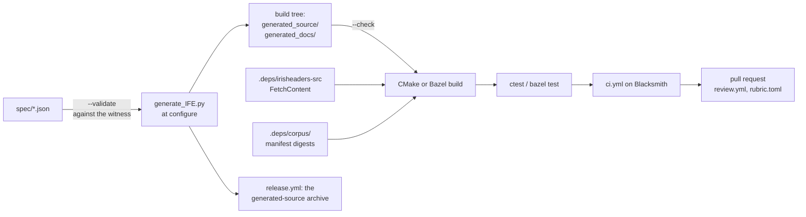

# Pipeline

How a change to Iris-File-Extension moves from the specification to a tested,
reviewed commit, and what CI checks on the way. The general CI rules are
[ci_runners.md](ci_runners.md) and the code rules
[style_guide.md](style_guide.md); these are the rules specific to this
repository, numbered so a commit or a comment can cite one ("PIPELINE.md,
rule 3"). Collected on 2026-11-24 from the rules the retired root documents
carried (the migration phases, the cross-pollination and release work orders,
CONTRIBUTING.md and CLAUDE.md), restated for the current workflow.

## Rules

1. **The specification first.** A wire change is an edit to `spec/*.json`;
   `python3 generate_IFE.py --validate` passes before anything is generated.
   Narrative goes in `spec/ife_spec.adoc`, and normative clauses live in the
   JSON so a diagnostic and the document cite one source (D1).
2. **Generated output is never edited or committed.** `generate_IFE.py`, the
   generator's one entry point, writes `generated_source/` and
   `generated_docs/` into the build directory at every configure, never into
   the source tree (R-7); the spec, the witness and the generator are
   configure dependencies, so a build after an edit regenerates first. A fix
   goes into `generator/emit/`. After a schema or emitter change, `touch
   <build>/generated_source/*.hpp` before rebuilding if the last link was in
   the same second, since Make compares modification times at one-second
   resolution and misses a header regenerated in it.
3. **Append-only, and the witness moves with the spec.** A shipped fact is
   never moved, resized, retyped, renamed or removed; retirement is
   `deprecated` with `{version, reason}` (D2). A change that adds a fact
   refreshes `tests/wire/witness.json` with `tools/refresh_witness.py` in the
   same commit; `--check` fails until it does. A task that seems to need
   breaking a shipped fact is a task written wrong; the two owner decisions
   that broke one are recorded in `tests/wire/README.md` (the latest, D26).
4. **Every test is registered in both build systems**, `tests/tests.cmake` and
   `tests/tests.bzl`. A defect reachable through only one build system is
   invisible; FastFHIR shipped a recovery engine Bazel was not compiling.
5. **The gate run**, chained with `&&` so that a failed build cannot report a
   pass from stale binaries:
   `cmake . -B build && cmake --build build --config Release -j && ctest --test-dir build -C Release --output-on-failure && python3 generate_IFE.py --check && python3 tools/portability_lint.py` (both read `build/generated_source/`, where this configure wrote it).
   Recovery and read-path work also runs `cmake --build --preset asan && ctest --preset asan`.
6. **Measure reads against a Release build.** Costs are about ten times higher
   at `-O0`, so a decision taken on a Debug build is taken on inflated numbers
   (D14).
7. **Never construct a block handle over a file with `b::VERSION_WRITTEN`.**
   Read major and minor from the file and construct with those, as
   `IFE_Runtime::versioned_root` does; otherwise `TILE_SIZE` on a 1.0 file
   returns the neighbouring block's VALIDATION word instead of reporting it
   absent, with no error.
8. **The corpus is hosted and pinned** (D16). `tests/corpus/manifest.json`
   names each fixture's URL, size, SHA-256, IFE version and block coverage;
   `tools/fetch_corpus.py` fetches into `.deps/corpus/` at configure and a
   failure is `FATAL_ERROR`. A manifest entry never names an object that is not
   yet hosted, since it breaks every configure. The fetch sends the user agent
   `ife-corpus-fetch/1.0`, because the host's bot protection refuses Python's
   default. CI caches the corpus by the manifest's digest.
9. **Iris-Headers is the one dependency**, fetched by CMake FetchContent into
   `.deps/irisheaders-src` at `IFE_IRIS_HEADERS_GIT_TAG` (default `main`,
   BL-7), and resolved by Bazel from the sibling checkout (`MODULE.bazel`).
   `-DFETCHCONTENT_SOURCE_DIR_IRISHEADERS=<path>` builds against a local
   checkout.
10. **CI on Blacksmith** (D23). Every job runs on a label Blacksmith documents,
    checked by `tools/runner_labels_lint.py` in the `spec` job, and has
    `timeout-minutes`; `CMAKE_BUILD_PARALLEL_LEVEL` sets the runner's vCPU
    count.
11. **Byte order is proved on a big-endian host.** The `big-endian (s390x)` job
    cross-compiles with `g++-s390x-linux-gnu` and runs every test under
    `qemu-s390x` (`cmake --workflow --preset big-endian`), without Docker (D4).
12. **The consumer builds against every change.** The `downstream` job clones
    Iris-Slide and builds it against this checkout (D5).
13. **Portability lint before pushing.** `python3 tools/portability_lint.py`
    catches in a second the failures that otherwise first appear on MSVC or
    under Bazel's sandbox.
14. **The review bot** (D24). `.github/workflows/review.yml` runs on
    `pull_request_target`, checks out only the default branch's commit and the
    bot's pinned commit, runs nothing from the head, and holds least privilege;
    `cmake -P cmake/check_review_configuration.cmake` in the `spec` job holds
    those properties, that each `run:` step is one `cmake -P` of a script in
    the base checkout (`cmake/require_settings.cmake`, or
    `cmake/review_bot.cmake` for a command of the bot), and that every file
    the rubric names exists. A change to
    the rubric, CODEOWNERS or `review.yml` needs the maintainer's explicit
    attention.
15. **The release** (R-3). `release.yml` runs `verify` → `package`,
    `document` and `generated` → `publish` on a tag; `generated` archives the
    C++ layer as `IrisFileExtension-<version>-generated-source.tar.gz` (R-7); `tools/release_guard.py` requires the tag,
    the declared version and the revision's ratification to agree before a
    compiler runs, and refuses a draft. `workflow_dispatch` runs everything but
    `publish`.
16. **Traceability.** A commit that changes code updates the WBS items it
    completes and the RTM rows it touches in the same commit; the tick links
    the commit that did the work, and a follow-up commit touching only
    `development/WBS.md` and `development/RTM.md` adds the link when the work
    commit cannot name its own hash ([README.md](README.md)).

## CI jobs

| Workflow | Job | Checks |
|---|---|---|
| `ci.yml` | `spec documents and drift` | runner labels, the review configuration, `--validate`, generate, `--check`, generator determinism under two hash seeds, `-d`, deprecation, the portability lint |
| `ci.yml` | `build and test` (GCC, Clang, MSVC, AppleClang, Xcode) | CMake build and `ctest` per compiler |
| `ci.yml` | `bazel build and test` (Linux, Windows) | `bazel test //...` |
| `ci.yml` | `Iris-Slide builds against this branch` | the consumer's build against this checkout |
| `ci.yml` | `address and undefined behaviour` | the suite under ASan and UBSan |
| `ci.yml` | `specification document` | `spec/build_document.sh` and its three gates |
| `ci.yml` | `emscripten (the residency branch)` | the WebAssembly build of `IFE_Window` |
| `ci.yml` | `big-endian (s390x)` | the suite on a big-endian host under emulation |
| `review.yml` | `1. Aptix Review Agent`, `2. Update PR from Agent` | the rubric's items, the commit trace |
| `release.yml` | `verify`, `package`, `document`, `generated`, `publish` | a tagged release |
