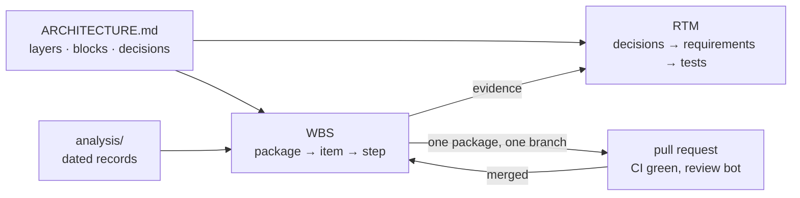

# development/

How Iris-File-Extension is planned, tracked and verified. The design contract
is [ARCHITECTURE.md](ARCHITECTURE.md): the layering, who governs each block of
the format, and the decisions the code follows. This folder breaks that
contract down to work packages, items and requirements. The format itself is
`spec/`; product documentation lives next to the code (README.md,
CONTRIBUTING.md, CLAUDE.md).

| File | Use it to… |
|---|---|
| [ARCHITECTURE.md](ARCHITECTURE.md) | know which layer owns which fact, who governs each block and which code writes and reads it, and the dated decisions and the decisions owed |
| [WBS.md](WBS.md) | track the work package by package: each item and its red-first steps, each tick with its evidence and commit link; the closed work, condensed |
| [RTM.md](RTM.md) | trace each requirement back to its decision or work item and forward to its tests, with status |
| [PIPELINE.md](PIPELINE.md) | the numbered rules a change follows from the specification to a reviewed commit, and what each CI job checks |
| [style_guide.md](style_guide.md) | the binding conventions for code, plans and prose |
| [ci_runners.md](ci_runners.md) | the rules every workflow follows: when a runner runs, reuse, caches, robustness |
| [analysis/](analysis/) | dated records the plan was built from, kept as written: the migration phases, the work orders, the recovery rebuild, the long write-ups of open items |

`analysis/` holds what the root `MIGRATION.md`, `TASKS.md` and
`architecture.md` recorded until 2026-11-24, when this folder replaced them;
git history keeps the originals. The review bot sends every file in this
folder except `analysis/` with each review (`.github/review/rubric.toml`), so
a long rationale belongs in `analysis/` and the WBS keeps one line for it.

## How a work package runs

1. The branch is named after the item it delivers (`feature/ReviewBot_CI-3`),
   chosen before the first push, since renaming a pull request's head branch
   closes the pull request. One branch and one pull request per package.
2. Each item that changes behaviour starts with a test shown red, recorded
   with its failure; then the code that turns it green, with the evidence
   (test counts, the command run).
3. The package ends with a **VERIFY** step for the maintainer and a **Gate**:
   CI green on the pull request.
4. A change that needs another repository first (Iris-Headers, Iris-Slide)
   names that pull request and the merge order. An item that waits on a
   decision is marked `blocked` and does not hold its package.

The pull request's description has the sections of
`.github/pull_request_template.md`, in order: Summary · Work items (ticked,
with evidence and commit links) · Specification impact · Decisions (dated,
stated as plain requirements) · Measurements · Test results (per cell) · Red
first · Failures fixed · Consumer impact · Security impact · AI authorship.

**Naming.** A work item keeps the ID it was given (`RB-5`, `RC-10.4`, `R-3.1`,
`VL-1.2`, `CI-3.6`, `OD-R1`): a series (`RB`, `R`, `CI`, `OD-R`), a package
number and an optional step number. A new item takes the next number in its series. An RTM row is
`PascalCaseArea_<nn>` (`Read_01`).

**Update rule.** A commit that changes code updates the WBS items it completes
and the RTM rows it touches, in the same commit; each tick and each row moved
to Implemented or Verified links the commit that did the work
([PIPELINE.md](PIPELINE.md), rule 16). Commits are staged by explicit path.
