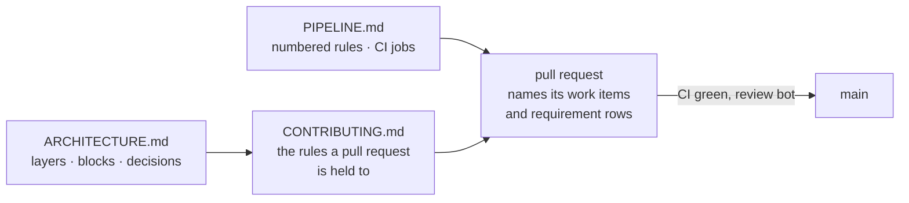

# development/

How Iris-File-Extension's design is recorded and how a change moves through
review. The design contract is [ARCHITECTURE.md](ARCHITECTURE.md): the
layering, who governs each block of the format, and the decisions the code
follows. The format itself is `spec/`; product documentation lives next to the
code (README.md, CONTRIBUTING.md, CLAUDE.md).

| File | Use it to… |
|---|---|
| [ARCHITECTURE.md](ARCHITECTURE.md) | know which layer owns which fact, who governs each block and which code writes and reads it, and the dated decisions and the decisions owed |
| [PIPELINE.md](PIPELINE.md) | the numbered rules a change follows from the specification to a reviewed commit, what each CI job checks, and the settings the workflows need |
| [../CONTRIBUTING.md](../CONTRIBUTING.md) | the rules a pull request is held to, as facts of this codebase: the wire contract, the code rules, picking work |

The work breakdown (packages, items, steps and their ticks), the requirements
traceability matrix and the dated records the plan was built from are kept
privately with the family's general conventions, since 2026-11-27 (D25). A
pull request names the work items and requirement rows it advances, and the
review bot's findings name the rule they apply.

## How a work package runs

1. The branch is named after the item it delivers
   (`<kind>/<WorkPackage>_<n>`, as `docs/ReviewRubric_1`), chosen before the
   first push, since renaming a pull request's head branch closes the pull
   request. One branch and one pull request per package.
2. Each item that changes behaviour starts with a test shown red, recorded
   with its failure; then the code that turns it green, with the evidence
   (test counts, the command run).
3. The package ends with a **VERIFY** step for the maintainer and a **Gate**:
   CI green on the pull request.
4. A change that needs another repository first (Iris-Headers, Iris-Slide)
   names that pull request and the merge order. An item that waits on a
   decision is marked `blocked` and does not hold its package.

The pull request's description has the sections of
`.github/pull_request_template.md`, in order: Summary · Work items (the IDs
completed or advanced) · Specification impact · Decisions (dated, stated as
plain requirements) · Measurements · Test results (per cell) · Red first ·
Failures fixed · Consumer impact · Security impact · AI authorship.

**Naming.** A work item keeps the ID it was given: a series, a package number
and an optional step number (`RB-5`, `RC-10.4`, `R-3.1`, `VL-1.2`, `CI-3.6`,
`OD-R1`), or a spelled-out name and a number (`ReviewRubric_1`,
`PlansPrivate_1`), the form the review bot recognises when it sends a pull
request's items to the model. A new item takes the next number in its series
or name. An RTM row is
`PascalCaseArea_<nn>` (`Read_01`); code carries `// RTM <ID>` and a Catch2
test the tag `[<ID>]`.

**Update rule.** A commit that changes code completes WBS steps and touches
RTM rows; each tick and each row moved to Implemented or Verified links the
commit that did the work, once that commit is pushed to the pull request's
branch, and the pull request names the items and rows
([PIPELINE.md](PIPELINE.md), rule 16). Commits are staged by explicit path.
