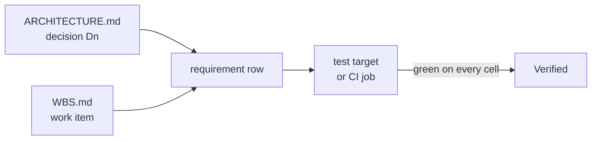

# Requirements Traceability Matrix

Every requirement traces back to the decision or work item it serves and
forward to the tests that prove it. A requirement is **Verified** when its
tests run green on every CI cell that runs them; code without that evidence is
**Implemented**.

- **Source:** `Dn` = a decision of [ARCHITECTURE.md](ARCHITECTURE.md) §1;
  `OD-Rn` = a decision owed (§1.1); `PIPELINE n` = rule n of
  [PIPELINE.md](PIPELINE.md); a work-item ID (`RB-5`, `VL-1`) = a row of
  [WBS.md](WBS.md).
- **Work item:** the WBS item that delivered or will deliver the row.
- **Tests:** the CTest or Bazel target, or the CI job, that proves the row.
  `Static` is a gate that reads the source or the specification; `Hostile` a
  damaged-file test run under AddressSanitizer; `Concurrency` a test under
  ThreadSanitizer; `Review` a document the maintainer reads.
- **Status:** Planned → Implemented → Verified (or Partial / Blocked, with a
  note). A row moved to Implemented or Verified links, in its status cell, the
  commit that did the work (`.github/review/rubric.toml`, `[trace]`). Rows
  whose code arrived with the repository's first commit at Aptix-Bio link that
  commit, [257b960](https://github.com/Aptix-Bio/Iris-File-Extension/commit/257b9607700eddcd261282767679b105705d3ff7),
  since the history before it was squashed.

## Requirements

| ID | Requirement | Source | Work item | Tests | Status |
|---|---|---|---|---|---|
| Spec_01 | Every wire fact is derived from `spec/*.json`; `generated_source/` and `generated_docs/` are rebuilt at configure and match the spec | D1 | Phases 1–3 | `python3 -m generator --validate` and `--check` (CI `spec documents and drift`), Static | Verified [257b960](https://github.com/Aptix-Bio/Iris-File-Extension/commit/257b9607700eddcd261282767679b105705d3ff7) |
| Wire_01 | A change to a shipped fact fails against `tests/wire/witness.json`; additions are accepted | D2 | XP-1 | `--validate` against the witness (CI `spec documents and drift`), Static | Verified [257b960](https://github.com/Aptix-Bio/Iris-File-Extension/commit/257b9607700eddcd261282767679b105705d3ff7) |
| Wire_02 | The generator's output is deterministic: reordering its inputs does not change it | D1 | XP-3 | `ife_generator_determinism` | Verified [257b960](https://github.com/Aptix-Bio/Iris-File-Extension/commit/257b9607700eddcd261282767679b105705d3ff7) |
| Wire_03 | The generated readers read the bytes a shipped 1.0 encoder wrote | D3 | Phase 6 | `ife_v1_oracle_tests`, `ife_runtime_tests` | Verified [257b960](https://github.com/Aptix-Bio/Iris-File-Extension/commit/257b9607700eddcd261282767679b105705d3ff7) |
| Wire_04 | Every 1.1 field reads its value on a 1.1 file and is absent on a 1.0 file; a newer minor warns | D3 | Phase 4 (4.5), R-6 | `ife_version_gating_tests`, `ife_version_gating_backward_tests`, `ife_v11_witness_tests` | Partial: the tests pass; R-6's completion is not yet recorded in the WBS [257b960](https://github.com/Aptix-Bio/Iris-File-Extension/commit/257b9607700eddcd261282767679b105705d3ff7) |
| Wire_05 | A deprecated enumeration member carries `{version, reason}`; the Builder refuses it by name; files that carry it still read | D19 | PngRetired | `tests/generator/test_deprecated.py` (`ife_generator_deprecated`), `ife_builder_layered_tests` | Verified [4556534](https://github.com/Aptix-Bio/Iris-File-Extension/commit/45565345674089be95b6277f4c3c9733b408c527) |
| Wire_06 | Tile encoding value 3 is `TILE_ENCODING_AV1`: the tile byte-stream is a bare AV1 sequence in the Low Overhead Bitstream Format with no container, one shown frame per focal plane, and a single-plane tile is one key frame; the store and read paths and the conformance layer accept it | D26 | TE-1 | `ife_blocks_tests` (`test_tile_encoding_av1_round_trips`), `ife_validation_tests`, `--validate` against the witness | Implemented [abd8082](https://github.com/Aptix-Bio/Iris-File-Extension/commit/abd80828ca6cfe2992fa7ed797e4918feadd622d) |
| Wire_07 | Which plane an AV1 tile stream codes as its key (in-focus) frame, and how decode order maps to focal depth, are specified | OD-T1 | TE-1.4 | *(to write)* | Blocked on OD-T1 |
| Bytes_01 | Multi-byte values are little-endian on disk on every host | D4 | CI-2 | `ife_bytes_tests`; `ife_host_byte_order_tests` and the whole suite under the `big-endian (s390x)` job | Verified [3c5560b](https://github.com/Aptix-Bio/Iris-File-Extension/commit/3c5560b0b8e561785ec7a963d167661706e764dc) |
| Read_01 | A handle's bool is `validate()`; `abstract_file_structure()` refuses a structurally damaged file with a `Result` naming the failure | D12 | RC-10.1 | `ife_validation_tests`, `ife_damage_sweep_tests` | Verified [257b960](https://github.com/Aptix-Bio/Iris-File-Extension/commit/257b9607700eddcd261282767679b105705d3ff7) |
| Read_02 | Every public read entry point stays inside the file for every single-bit flip of every fixture, and a file that validates can be read | D12 | RB-1 | `ife_damage_sweep_tests` (CI `address and undefined behaviour`), Hostile | Verified [257b960](https://github.com/Aptix-Bio/Iris-File-Extension/commit/257b9607700eddcd261282767679b105705d3ff7) |
| Read_03 | `Parser::open` owns its mapping; `tile()`, `image()` and `tile_planes()` return bounds-checked zero-copy spans | D6 | handle layer (2026-09-28) | `ife_parser_tests` | Verified [257b960](https://github.com/Aptix-Bio/Iris-File-Extension/commit/257b9607700eddcd261282767679b105705d3ff7) |
| Read_04 | No view the abstraction returns outlives the mapping it reads | D14 | XP-4 | `ife_lifetime_tests`, Hostile | Verified [257b960](https://github.com/Aptix-Bio/Iris-File-Extension/commit/257b9607700eddcd261282767679b105705d3ff7) |
| Read_05 | The read path builds no `std::vector` per call over resident data; layout tables are exposed as `std::span<const T>` | D14 | ZC-1 to ZC-5 | a Release-build benchmark *(to write)* | Planned |
| Write_01 | The Builder writes every block; the caller places them, and the same inputs round-trip through the read path in either of two layouts | D6, D7 | handle layer (2026-09-30) | `ife_builder_tests`, `ife_builder_layered_tests` | Verified [257b960](https://github.com/Aptix-Bio/Iris-File-Extension/commit/257b9607700eddcd261282767679b105705d3ff7) |
| Write_02 | The arena never remaps; a file over 4 GiB is written and validated | D8 | Phase 6 | `ife_large_file_tests`, `ife_builder_tests` | Verified [257b960](https://github.com/Aptix-Bio/Iris-File-Extension/commit/257b9607700eddcd261282767679b105705d3ff7) |
| Write_03 | A tile nobody accounted for refuses `finalize`; every stream of a Z-stacked layer is framed | D9, D10 | handle layer (2026-09-28) | `ife_builder_tests`, `ife_builder_layered_tests` | Verified [257b960](https://github.com/Aptix-Bio/Iris-File-Extension/commit/257b9607700eddcd261282767679b105705d3ff7) |
| Write_04 | `append_clinical` writes the file's one clinical stream and METADATA names it; a second stream or an undefined encoding is refused with nothing claimed | D18 | ClinicalWriter | `ife_builder_layered_tests` | Verified [b413498](https://github.com/Aptix-Bio/Iris-File-Extension/commit/b413498c959ca30e8a9aac626e13029812a57d3e) |
| Validate_01 | The validation layer's checks are emitted from the schema's normative clauses and attach at `store()` | D1 | Phase 4 (4.6) | `ife_validation_tests` | Verified [257b960](https://github.com/Aptix-Bio/Iris-File-Extension/commit/257b9607700eddcd261282767679b105705d3ff7) |
| Validate_02 | Concurrent failing stores through one hooks struct lose no diagnostic and race on nothing: `lines + dropped == failures` | D20 | VL-1 | a ThreadSanitizer test *(VL-1.6)*, Concurrency | Planned |
| Recovery_01 | The census of a clean file is one attached island matching `generate_file_map`; every single flip opens exactly the points it explains; a newer writer's skew is no hole | D13 | RB-2, RB-3 | `ife_recovery_tests`, `ife_runtime_tests` | Verified [257b960](https://github.com/Aptix-Bio/Iris-File-Extension/commit/257b9607700eddcd261282767679b105705d3ff7) |
| Recovery_02 | Each header field gets a verdict, and the version and trusted extent are decided first | D13 | RB-4 | `ife_recovery_tests` *(to extend)*, Hostile | Planned |
| Recovery_03 | The branch solver repairs blocks with zero wrong writes; Ambiguous and Unrecovered write nothing | D13, OD-R3, OD-R4 | RB-5, RB-7 | `ife_recovery_tests` *(to extend)*, Hostile | Planned |
| Recovery_04 | A lost `TILE_OFFSETS` array is rebuilt from tile frames; an unframed stream is reported and never repointed | D10, D13 | RB-6 | `ife_recovery_tests` *(to extend)*, Hostile | Planned |
| Recovery_05 | `apply` writes into the target OD-R1 chooses, each group whole or rolled back | OD-R1 | RB-7 | *(to write)* | Planned |
| Recovery_06 | A whole-file checksum footer detects a change no block witness can see | D2 | RC-5 | *(to write)* | Planned |
| Corpus_01 | The hosted fixtures are pinned by SHA-256, fetched at configure, fail loudly when unreachable, and reach all 18 block types as the manifest declares, both ways | D16 | R-1, R-2 | `ife_corpus_tests` | Verified [257b960](https://github.com/Aptix-Bio/Iris-File-Extension/commit/257b9607700eddcd261282767679b105705d3ff7) |
| Api_01 | The shared library exports exactly the semantic API; the block layer stays out of it | D5 | Phase 4 (4.0-D) | `ife_exported_symbols` | Verified [257b960](https://github.com/Aptix-Bio/Iris-File-Extension/commit/257b9607700eddcd261282767679b105705d3ff7) |
| Api_02 | The header-only route compiles in two translation units without an ODR violation | D5 | Phase 4 | `ife_header_only_odr_tests`, `ife_blocks_header_only_tests` | Verified [257b960](https://github.com/Aptix-Bio/Iris-File-Extension/commit/257b9607700eddcd261282767679b105705d3ff7) |
| Api_03 | The README's examples compile as published | D6 | handle layer (2026-09-28) | `ife_readme_compiles` | Verified [257b960](https://github.com/Aptix-Bio/Iris-File-Extension/commit/257b9607700eddcd261282767679b105705d3ff7) |
| Api_04 | Iris-Slide builds against every change to this repository | D5 | CI-2.4 | CI `Iris-Slide builds against this branch`, Integration | Verified [bcf1eb6](https://github.com/Aptix-Bio/Iris-File-Extension/commit/bcf1eb6176604c598bfd6ee4da04c75085ff280e) |
| Doc_01 | The specification document renders to HTML and PDF through all three gates of `spec/build_document.sh` | D1 | Phase 5 | CI `specification document` | Verified [257b960](https://github.com/Aptix-Bio/Iris-File-Extension/commit/257b9607700eddcd261282767679b105705d3ff7) |
| Release_01 | A release tag, the declared version and the revision's ratification agree before a compiler runs; a draft is refused | D15 | R-3 | `tools/release_guard.py` in `release.yml` `verify` (never run on a tag) | Implemented [257b960](https://github.com/Aptix-Bio/Iris-File-Extension/commit/257b9607700eddcd261282767679b105705d3ff7) |
| Release_02 | Python bindings over the abstraction layer, built behind their own CMake option and in CI | D15 | R-4 | *(to write)* | Planned |
| Release_03 | JavaScript/WebAssembly bindings over the residency transport | D15 | R-5 | *(to write)* | Planned |
| Pipeline_01 | Every CI job runs on a documented Blacksmith label and is bounded by `timeout-minutes` | D23 | CI-1 | `tools/runner_labels_lint.py` (CI `spec documents and drift`), Static | Verified [79a2fb7](https://github.com/Aptix-Bio/Iris-File-Extension/commit/79a2fb79a836a9b7e547aab3101786c2f90ed83d) |
| Pipeline_02 | The review workflow runs no pull request code, holds least privilege, skips forks, pins every action and makes each `run:` step one `cmake -P` of a script; the rubric's reference and trace files exist | D24 | CI-3 | `cmake -P cmake/check_review_configuration.cmake` (CI `spec documents and drift`), Static | Implemented [83c4fe4](https://github.com/Aptix-Bio/Iris-File-Extension/commit/83c4fe42b4f124ac5305b5b38d18a81ec4f8138c), [47cd97c](https://github.com/Aptix-Bio/Iris-File-Extension/commit/47cd97c65c26e897e5ead97af2a6616e77cea05e) (the trace-file check), [83b113d](https://github.com/Aptix-Bio/Iris-File-Extension/commit/83b113dabefb6f6b77d040e043b8baf31e738d18) |
| Pipeline_03 | The source carries none of the constructs that have failed only on MSVC or under Bazel (a Windows header macro used as a name, `ctest` without `-C`, a header Bazel's sandbox cannot see) | PIPELINE 13 | Phase 4 | `tools/portability_lint.py` (CI `spec documents and drift`), Static | Verified [257b960](https://github.com/Aptix-Bio/Iris-File-Extension/commit/257b9607700eddcd261282767679b105705d3ff7) |
| Process_01 | The plan lives in `development/`, every work-item ID of the retired root documents is kept, and every open item is in the WBS | D25 | CI-3.6 | `python3 tools/check_planning_move.py .`, Review | Implemented [47cd97c](https://github.com/Aptix-Bio/Iris-File-Extension/commit/47cd97c65c26e897e5ead97af2a6616e77cea05e) |
