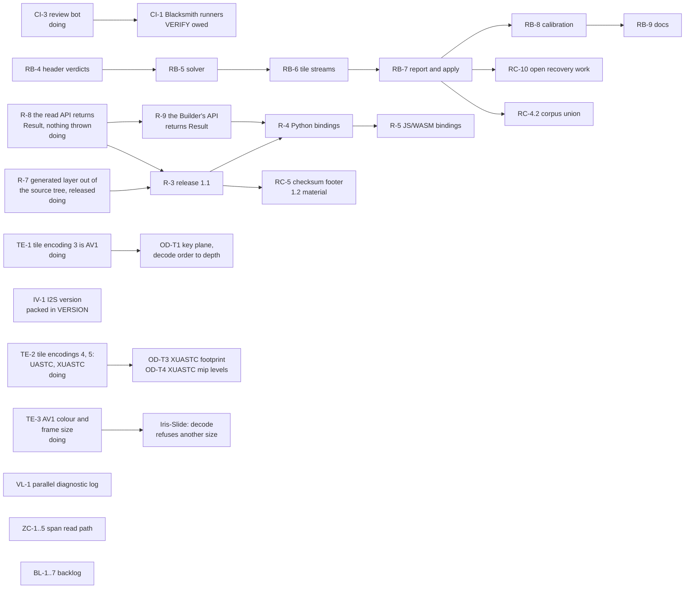

# Work Breakdown Structure

The tracking sheet for Iris-File-Extension's work. Each **work package**
states its purpose and its status; the **items** under it are the checkable
steps, red first, each ticked with its evidence and a link to the commit that
did the work. Requirements live in [RTM.md](RTM.md); decisions, the block
register and the decisions owed in [ARCHITECTURE.md](ARCHITECTURE.md); the
pipeline rules in [PIPELINE.md](PIPELINE.md); long write-ups and the full
record of closed work in [analysis/](analysis/).

The work-item IDs are the ones the retired root documents gave (`MIGRATION.md`,
`TASKS.md`, 2026-08 to 2026-11), kept so every reference in code, commits and
pull requests still resolves. IDs added on 2026-11-24 for items that had none:
ZC-1 to ZC-5, BL-1 to BL-7, RB-0.d and CI-3.6.

## Conventions

- **A work package is one branch and one pull request.** The branch is
  `<kind>/<Name>_<ID>` after the item it delivers (`feature/ReviewBot_CI-3`),
  chosen before the first push, since renaming a pull request's head branch
  closes the pull request. A pull request names the items it completes or
  advances; [README.md](README.md) gives its sections.
- **Red first.** An item that changes behaviour starts with a test shown
  failing, with the failure quoted; it is ticked only with the green evidence.
  An item whose product is a measurement or a document is ticked with the
  numbers or the review.
- **One tick, one piece of evidence, one commit link, on the tick's own line:**
  `- [x] CI-2.4 **Title.** evidence [1234567](https://github.com/Aptix-Bio/Iris-File-Extension/commit/<full hash>)`.
  The review bot checks every new tick in this file (`.github/review/rubric.toml`,
  `[trace]`).
- **VERIFY** is the maintainer's check; **Gate** is CI green on the pull request.
- **Status** after a package's name: `todo`, `doing`, `blocked` (with what it
  waits on), `done`. A blocked item does not hold its package: the package
  merges without it.
- **Closed work** is condensed in the table at the end; its full record,
  evidence included, is the `analysis/` file the row names.

## Plan

RB-4 to RB-9 run in order, each ending at its gate. R-3 waits on the
maintainer's review of the 1.1 revision (R-3.1). VL-1, ZC and the backlog
touch different files from the recovery lane and can run beside it.

| Package | Purpose | Status |
|---|---|---|
| CI-3 | the review bot reviews every pull request; the plan moves to `development/` | `doing` (pull request #6) |
| TE-1 | tile encoding value 3 is `TILE_ENCODING_AV1`, a bare AV1 sequence, in place of AVIF | `doing` (pull request #7, stacked on #6); TE-1.4 `blocked` on OD-T1 |
| IV-1 | `ATTRIBUTES.VERSION` under `METADATA_I2S` is the I2S version packed as `major << 8 \| minor` (D27) | `doing` (pull request #8, stacked on #7) |
| TE-2 | tile encodings 4 and 5 are `TILE_ENCODING_UASTC` and `TILE_ENCODING_XUASTC`, bare GPU block-compressed streams | `doing` (pull request #9, stacked on #8); TE-2.5 `blocked` on OD-T3, TE-2.6 on OD-T4 |
| TE-3 | AV1 tiles' first sequence header agrees with IFE's blocks (TILE_LENGTH, the encoding's BT.601 full-range 8-bit colour, the plane count), from the schema's `external_check`, in `validate_file_structure` and the validation layer (D31) | `doing` (branch `feature/Av1ColorAndSize_TE-3`; its pull request waits on #11) |
| CI-1 | every CI job on a pinned Blacksmith runner | `done`; VERIFY and the macOS gating owed |
| VL-1 | the validation layer's diagnostic sink is safe under a multithreaded writer | `todo` (P1, latent) |
| RB-4 to RB-9 | the recovery census grows its solver, tile streams, report, apply and calibration | `todo`; RB-5 to RB-7 wait on OD-R1, OD-R3, OD-R4, OD-R5 defaults |
| RC-4, RC-5, RC-10 | open items of the recovery work orders | `todo`; RC-10.3 and RC-10.8 are Iris-Slide's half |
| R-3 | release 1.1 | `blocked` on the maintainer's review of the revision (R-3.1) |
| R-4, R-5 | Python and JavaScript/WebAssembly bindings | `todo`, after R-3 (D15) |
| R-6 | an expectations header for the 1.1 witness | `doing`: the test exists, its record is owed |
| R-7 | `generate_IFE.py` is the generator's one entry point; the generated layer is built out of the source tree and published with each release | `doing` (pull request #10, stacked on #9) |
| R-8 | no exception crosses the public read API: every read entry point is `noexcept`, returns a `Result` and writes its value through an output reference | `doing` (pull request #11; Iris-Slide's call sites on its paired branch, Iris-Slide#4; `downstream` red as a coordinated change until #4 merges) |
| R-9 | the Builder's public API returns a `Result` in the same form | `todo`, before R-4 |
| ZC-1 to ZC-5 | the read path as a const lens (D14) | `todo` |
| BL-1 to BL-7 | carried forward, none gating the release | `todo` |

---

## CI-3 — The Aptix governance review bot reviews every pull request `doing`

Every non-draft pull request from a branch of this repository is reviewed by
the Aptix review bot against `.github/review/rubric.toml` (D24). Design,
sources and the bot's pinned commit:
[analysis/blacksmith_ci_and_review_bot_2026-11-24.md](analysis/blacksmith_ci_and_review_bot_2026-11-24.md).
Branch `feature/ReviewBot_CI-3`, pull request #6.

- [x] CI-3.1 **Red first.** `cmake/check_review_configuration.cmake`, run by the `spec` job, fails on any change that would let `review.yml` run a pull request's code, widen a job's token, move a secret or unpin an action. Evidence: exit 1 at the test's own commit, naming the four missing files. [d68abca](https://github.com/Aptix-Bio/Iris-File-Extension/commit/d68abcaffb499cc1d4249265e18c97c5308b1a33)
- [x] CI-3.2 **Green.** The workflow, rubric, CODEOWNERS and pull request template added; the check exits 0. actionlint 1.7.12 reports only the three shellcheck notes `main` already had; `tools/runner_labels_lint.py` and `tools/portability_lint.py` pass. [83c4fe4](https://github.com/Aptix-Bio/Iris-File-Extension/commit/83c4fe42b4f124ac5305b5b38d18a81ec4f8138c)
- [x] CI-3.3 **The rubric loads in the pinned bot.** `load_rubric` and `code_owners` at the pinned governance commit (Python 3.15.2, its hash-pinned requirements): 13 items, 12 blocking and Documentation advisory; `[trace]` on TASKS.md and MIGRATION.md; the owners on CODEOWNERS' catch-all line; all 13 reference files present; MIGRATION.md was then dropped from them to cut each review by two-thirds, leaving 12. [83c4fe4](https://github.com/Aptix-Bio/Iris-File-Extension/commit/83c4fe42b4f124ac5305b5b38d18a81ec4f8138c)
- [ ] CI-3.4 **VERIFY:** the first review run, on the first pull request
      opened after this merges (`pull_request_target` runs the default
      branch's workflow, so this pull request gets none).
- [ ] CI-3.5 **Required check.** Making `2. Update PR from Agent` a required
      status check on `main` is a repository setting for the maintainer.
- **CI-3.6** — the root planning documents become `development/` (D25):
  `MIGRATION.md`, `TASKS.md` and `architecture.md` retired into
  ARCHITECTURE, WBS, RTM, PIPELINE and `analysis/`, every work-item ID kept,
  every reference updated, and the rubric's reference set and `[trace]`
  pointed at the new files [Process_01]
  - [x] CI-3.6.1 **Nothing dropped.** The move's checker (`python3 tools/check_planning_move.py .`) lists every work-item ID and every box of the three retired files at [005347e](https://github.com/Aptix-Bio/Iris-File-Extension/commit/005347ee3dd9ef802b967d795db17e564a7c8a27) and finds each in `development/`: 107 work-item IDs, the 44 open ones in WBS.md; 37 open boxes, all in WBS.md; 79 ticked boxes, all in `development/`. A WBS copy with RB-5 deleted fails it, naming RB-5. [47cd97c](https://github.com/Aptix-Bio/Iris-File-Extension/commit/47cd97c65c26e897e5ead97af2a6616e77cea05e)
  - [x] CI-3.6.2 **References and rubric.** `grep` finds the retired files named only in provenance notes and the dated records; the rubric sends 15 reference files (211,205 characters, from 446,068 with MIGRATION.md), and `[trace]` names WBS.md ticks and RTM.md rows; `cmake -P cmake/check_review_configuration.cmake` exits 0, and its new `[trace]` file check exits 1 on the base rubric with MIGRATION.md deleted, which the base check passed. [47cd97c](https://github.com/Aptix-Bio/Iris-File-Extension/commit/47cd97c65c26e897e5ead97af2a6616e77cea05e)
  - [x] CI-3.6.3 **The pinned bot loads it.** `load_rubric` at the pinned governance commit: 13 items, `[trace]` on WBS.md and RTM.md, all 15 reference files present; the 14 Mermaid diagrams of `development/` render (mermaid-cli). [47cd97c](https://github.com/Aptix-Bio/Iris-File-Extension/commit/47cd97c65c26e897e5ead97af2a6616e77cea05e)
  - [ ] CI-3.6.4 **VERIFY:** the maintainer reviews `development/`.
- [x] CI-3.7 **Nesting at most three levels.** `cmake/check_review_configuration.cmake` (five levels at the governance checkout's checks, four in the per-line checks and the CODEOWNERS check) and `tools/check_planning_move.py` (four at the open-box check) move their inner loops into helper functions, as development/style_guide.md, Control flow, requires. The check now counts problems in a global property, so a helper at any depth reports one. Evidence: nesting at most 3 in both (a count of if/foreach/while depth; 5 before); of 18 mutations of review.yml, CODEOWNERS and the rubric, the base check let one pass (`actions/checkout@v7`) and the refactored check fails all 18; the move's checker prints the same report, and fails on a WBS copy without RB-5. [64a4ee0](https://github.com/Aptix-Bio/Iris-File-Extension/commit/64a4ee0e410c8de2ff3132ea19313fe8e219a891)
- [x] CI-3.8 **Red first: one command per `run:` step.** The check requires every `run:` step of `review.yml` to be one `cmake [-D...] -P base/cmake/<name>.cmake` command (development/ci_runners.md, "Workflows are simple; CMake does the work"); it exits 1 on the four steps that call Python or `echo` directly (`transcript-key`, `review`, `publish`, the fork notice). Evidence: exit 1 at the test's own commit, 4 problems, one per step. [78f7023](https://github.com/Aptix-Bio/Iris-File-Extension/commit/78f702328dbbc69d514fe0b73955915342f2cf09)
- [x] CI-3.9 **Green.** `cmake/review_bot.cmake` runs one command of the bot (`-DSTEP=transcript-key`, `review`, `publish` or `fork-notice`) with the values the step's `env:` sets, refuses a missing value or one holding `;` (a CMake list separator) by name, and fails when `review` writes no `verdict.json` or an empty one; each `run:` step of `review.yml` is one `cmake -P`, and `fork-skipped` checks out the default branch's commit (contents: read) for its script. The check also requires each script a step runs to exist. `review.yml`'s comments give the bot's 128,000 output tokens (`MAX_TOKENS` at the pinned commit) and why 30 minutes bound them, and say why the settings check is each job's second step. Evidence: the check exits 0; 21 mutations each exit 1; `review_bot.cmake` against a stand-in bot passes each command's arguments and exits 1 on each of its six refusals; actionlint 1.7.12 reports nothing in `review.yml`; ctest 25 of 25 (Release, AppleClang); `--validate`, `--check`, both lints and the move's checker pass. [83b113d](https://github.com/Aptix-Bio/Iris-File-Extension/commit/83b113dabefb6f6b77d040e043b8baf31e738d18)
- [ ] CI-3.10 **The merge-verification job.** The bot's `verify` command ticks the description's human-verification line from a job that waits on a `merge-verification` environment, as governance's own workflow runs it. IFE's rubric sets `[verification] allow_author` but no rubric item requires the job, and the environment is a repository setting for the maintainer, so the job is not added until the environment exists (`todo`).

## CI-1 — Every CI job runs on a pinned Blacksmith runner `done`; VERIFY owed

Decided 2026-11-24 (D23): CI runs on Blacksmith runners, a label change kept
minimal so the workflows stay simple. The label table and its sources are in
[analysis/blacksmith_ci_and_review_bot_2026-11-24.md](analysis/blacksmith_ci_and_review_bot_2026-11-24.md).

- [x] CI-1.1 **Red first.** `tools/runner_labels_lint.py` (run by the `spec` job) fails on a GitHub-hosted label, a label Blacksmith does not document, or a `-latest` label: 44 findings on the base [136dc1c](https://github.com/Aptix-Bio/Iris-File-Extension/commit/136dc1ccb5e23e9f7554f2867786a4cb1c605ec8), exit 1; exit 0 after the move. [79a2fb7](https://github.com/Aptix-Bio/Iris-File-Extension/commit/79a2fb79a836a9b7e547aab3101786c2f90ed83d)
- [x] CI-1.2 **Bounded.** Every job has `timeout-minutes`; `CMAKE_BUILD_PARALLEL_LEVEL` replaces the bare `-j` with the runner's vCPU count (2 on Linux and Windows, 6 on macOS). [79a2fb7](https://github.com/Aptix-Bio/Iris-File-Extension/commit/79a2fb79a836a9b7e547aab3101786c2f90ed83d)
- [ ] CI-1.3 **VERIFY:** every job green on Blacksmith. First run (45429158071,
      2026-11-24): every job started on a Blacksmith runner; spec and document
      green; the CMake, Bazel, Emscripten and big-endian builds failed at
      configure or compile because Iris-Headers' `main` then lacked the
      `IrisSlide` rename. Since then, run 45456544767 on pull request #6
      (2026-11-24) passed all 13 jobs on Blacksmith; the maintainer ticks this.
- [ ] CI-1.4 **macOS last.** A macOS minute bills as twenty 2-vCPU Linux minutes
      (same page, FAQ); gating the macOS legs on the others (`needs:`) waits for
      the per-platform reusable workflow decided 2026-11-24 (unified
      workflows whose steps are CMake scripts, so a step runs the same
      locally and in CI).
- [x] CI-1.5 Record in `development/WBS.md` and `development/RTM.md` once those files are committed: done by CI-3.6, where CI-1 is this section and RTM row Pipeline_01. [47cd97c](https://github.com/Aptix-Bio/Iris-File-Extension/commit/47cd97c65c26e897e5ead97af2a6616e77cea05e)

## CI-2 — The big-endian job runs on Blacksmith without Docker `done`

The `big-endian (s390x)` job failed in 22 seconds on Blacksmith because the
binfmt_misc registration for s390x did not hold inside the runner's microVM.
The job now cross-compiles with `g++-s390x-linux-gnu` and runs every test under
`qemu-s390x` through `CMAKE_CROSSCOMPILING_EMULATOR`
(`cmake --workflow --preset big-endian`). Cause and evidence:
[analysis/blacksmith_ci_and_review_bot_2026-11-24.md](analysis/blacksmith_ci_and_review_bot_2026-11-24.md).

- [x] CI-2.1 **The binaries are big-endian.** `ife_host_byte_order_tests`: the test binary is an ELF with `EI_DATA=2` and `e_machine=22` (S390); emulated it prints `compiled for big; memory layout big` and exits 0; the same source compiled natively exits 1. [3c5560b](https://github.com/Aptix-Bio/Iris-File-Extension/commit/3c5560b0b8e561785ec7a963d167661706e764dc)
- [x] CI-2.2 **Local green.** The preset passes 26 of 26 tests in an Ubuntu 24.04 arm64 container (CMake 3.28.3, 2026-11-24). [3c5560b](https://github.com/Aptix-Bio/Iris-File-Extension/commit/3c5560b0b8e561785ec7a963d167661706e764dc)
- [x] CI-2.3 **VERIFY:** `big-endian (s390x)` green on pull request #1, run 45447197501, job 138634119321: 26 of 26 tests under emulation in 2 min 46 s. [3c5560b](https://github.com/Aptix-Bio/Iris-File-Extension/commit/3c5560b0b8e561785ec7a963d167661706e764dc)
- [x] CI-2.4 **Downstream.** Green in run 45448367106 at [bcf1eb6](https://github.com/Aptix-Bio/Iris-File-Extension/commit/bcf1eb6176604c598bfd6ee4da04c75085ff280e) *Amended 2026-11-25 (R-8):* from Iris-Slide's move to vcpkg ports (2026-11-24) the job built Iris-Slide's pinned IFE commit, since its FETCHCONTENT override was unused, so the green runs after that date did not test this repository; R-8.2 builds through Iris-Slide's overlay port, and RTM Api_04 is Implemented again until its runs are green.
      (job 138638305129, `Iris-Slide builds against this branch`, 3 min 54 s,
      on PR #1, 2026-11-24; every job in that run passed). Run 45447197501 had
      failed this job at configure with "Could not find nasm": Iris-Slide
      merged its vcpkg build (Iris-Slide cc17fb3) between run 45440640914 and
      that one, and vcpkg's aom port needs NASM from the host. The job's apt
      line now adds `nasm` and `pkg-config`, the tools Iris-Slide's own
      `_build.yml` installs.

## TE-1 — Tile encoding value 3 is `TILE_ENCODING_AV1` `doing`

Decided 2026-11-25 (D26): the AVIF tile encoding is removed and value 3 of
`tile_encodings` becomes `TILE_ENCODING_AV1`. The tile byte-stream is a bare
AV1 sequence in the Low Overhead Bitstream Format (AV1 specification §5.2,
https://aomediacodec.github.io/av1-spec/, read 2026-11-25), with no container:
one shown frame per focal plane, and a single-plane tile is one key frame. No
file in use carries the AVIF tile encoding, so the value is reassigned in
place instead of deprecated. `IMAGE_ENCODING_AVIF` (associated images) stays.
Specification: `spec/ife_constants.json` and `spec/ife_spec.adoc`, AV1 Tile
Byte-Streams. [Wire_06, Wire_07]

- [x] TE-1.1 **Red first.** The round-trip and conformance tests name `TILE_ENCODING_AV1`; the build fails with "no member named 'TILE_ENCODING_AV1' in 'Iris::File::constants::TileEncodings'" (`ife_blocks_tests.cpp:1243`, `ife_validation_tests.cpp:157`). [50230d5](https://github.com/Aptix-Bio/Iris-File-Extension/commit/50230d55f58aa35445189b4711b540f7c04ba55c)
- [x] TE-1.2 **Green.** The member is renamed and defined in the JSON and the specification text; the witness key is renamed by hand (the refresh tool refuses a break) and `tests/wire/README.md` records the break; the generated sources and documents are rebuilt; the example takes the name from the generated `member_name`. ctest 25 of 25 (Release) and 25 of 25 under ASan and UBSan; `--validate`, `--check`, both lints and `spec/build_document.sh` pass. [abd8082](https://github.com/Aptix-Bio/Iris-File-Extension/commit/abd80828ca6cfe2992fa7ed797e4918feadd622d)
- [ ] TE-1.3 **VERIFY:** the maintainer reviews the AV1 clause of the specification.
- [x] TE-1.5 **The exception is recorded.** Value 3 is a member of the ratified 1.0 group, so its reassignment breaks append-only; the code owner sanctions it (2026-11-25) because IFE has no deployed corpus. `tests/wire/README.md`, D26, the 1.1 revision summary and CONTRIBUTING.md's absolutes record it; `tools/refresh_witness.py` has no path that records a break, so the witness key stays renamed by hand. Evidence: `--validate` and `--check` pass and `tools/refresh_witness.py` reports the witness unchanged; ctest 25 of 25 (Release, AppleClang). [7afa979](https://github.com/Aptix-Bio/Iris-File-Extension/commit/7afa9797cb1a3dc3301ab73681a193806218de4c)
- [ ] TE-1.4 **Which plane is the key (in-focus) frame, and the mapping of decode order to focal depth.** `blocked` on OD-T1 (ARCHITECTURE.md §1.1). No key-plane field and no frame-to-depth ordering rule is added until it is decided; the specification marks both open.

## IV-1 — `ATTRIBUTES.VERSION` under `METADATA_I2S` is the I2S version, packed `doing`

Decided 2026-11-25 (D27): the u16 `ATTRIBUTES.VERSION` of a block declaring
`METADATA_I2S` holds the Iris Interoperability Specification version as
`major << 8 | minor` (I2S 0.1 is 0x0001, I2S 1.0 is 0x0100); zero is
unversioned, which a reader already takes as free text (D17). The rule is
prose about a value, not a wire fact, so `tests/wire/witness.json` is
unchanged. Specification: `spec/ife_fields.json` (VERSION),
`spec/ife_constants.json` (`METADATA_I2S`) and the ife-attributes clause of
`spec/ife_spec.adoc`. [Wire_08]

- [x] IV-1.1 **Red first.** `tests/generator/test_attributes_version.py` (ctest `ife_generator_attributes_version`) requires the packing as a "shall" in the schema and the narrative, with the unpacking and both examples, in the emitted tables, and off the wire: 25 of 26, the new test failing with 14 FAIL lines. `ife_builder_layered_tests` round-trips `METADATA_I2S` at VERSION 0x0001 and reads back both halves; it records behaviour the Builder already had and was green. [d9acd91](https://github.com/Aptix-Bio/Iris-File-Extension/commit/d9acd91b5ab6b727728521cf24500ba05fd4661d)
- [x] IV-1.2 **Green.** The VERSION and `METADATA_I2S` descriptions, the 1.1 revision summary and the ife-attributes clause state the rule; ctest 26 of 26 (Release); `--validate`, `--check` (no drift, witness not stale, so no refresh), both lints and `spec/build_document.sh` pass, and the rendered clause shows `major << 8 | minor`. [86ffcea](https://github.com/Aptix-Bio/Iris-File-Extension/commit/86ffceaa8f466e5dffe168629baedf4df3506ccb)
- [ ] IV-1.3 **VERIFY:** the maintainer reviews the ife-attributes clause.

## TE-2 — Tile encodings 4 and 5 are `TILE_ENCODING_UASTC` and `TILE_ENCODING_XUASTC` `doing`

Decided 2026-11-25 (D28): two GPU block-compressed tile encodings follow
`TILE_ENCODING_AV1` in the 1.1 group, so a reader can transcode a tile to the
block format its GPU samples (ASTC 4x4 or BC7) instead of decoding it to
pixels. Each tile byte-stream is a bare codec stream with no KTX2 or other
container: under `TILE_ENCODING_UASTC` (4), one Zstandard frame (RFC 8878
§3.1.1) of the tile's 16-byte UASTC LDR 4x4 blocks in raster order; under
`TILE_ENCODING_XUASTC` (5), one XUASTC LDR bitstream (XUASTC LDR
Specification v1.0, stream version 1). One plane each; the mip levels are
set once for the slide (D29, TE-2.4). The sources are cited in D28 and D29,
read 2026-11-25. Specification:
`spec/ife_constants.json` and `spec/ife_spec.adoc`, UASTC Tile Byte-Streams,
XUASTC Tile Byte-Streams, Mip Levels of Block-Compressed Tiles. Encoding and
decoding are Iris-Slide's; the encoder's size parity with JPEG is an
Iris-Slide requirement. [Wire_09, Wire_10, Wire_11, Wire_12]

- [x] TE-2.1 **Red first.** The round-trip test loops over AV1, UASTC and XUASTC and the conformance test accepts both new members; the build fails with "no member named 'TILE_ENCODING_UASTC' in 'Iris::File::constants::TileEncodings'" (`ife_blocks_tests.cpp:1240`, `:1241`). [f91d5a4](https://github.com/Aptix-Bio/Iris-File-Extension/commit/f91d5a493b9a1230d805ea3b2c64b8440bcdd68c)
- [x] TE-2.2 **Green.** Both members are defined in the JSON's 1.1 group and in the specification text; the witness is refreshed with `tools/refresh_witness.py` (an addition); the generated sources and documents are rebuilt; the Builder's `append_tile` comment names both. ctest 26 of 26 (Debug) and 26 of 26 under ASan and UBSan; `--validate`, `--check`, determinism under two seeds, both lints and `spec/build_document.sh` pass. [fa7259a](https://github.com/Aptix-Bio/Iris-File-Extension/commit/fa7259ace7ed71b1a12fe4a758a9143007a38380)
- [ ] TE-2.3 **VERIFY:** the maintainer reviews the UASTC, XUASTC and mip-level clauses of the specification.
- **TE-2.4** — a fixed number of mip levels per slide, recorded once in
  `TILE_TABLE.MIP_LEVELS` instead of per-tile fields in the tile frame
  (decided 2026-11-25, D29, resolving OD-T2). UASTC levels sit back to back,
  finest first, in the one Zstandard frame, each offset computed; XUASTC
  stays at one level, since its bitstream records no total length. [Wire_10]
  - [x] TE-2.4.1 **Red first.** `ife_builder_layered_tests` (k) writes a UASTC slide with `MIP_LEVELS` 3 through the Builder and reads 3 through the Parser, and refuses 8 levels of a 256-pixel tile, 7 of a 128-pixel one and 2 under XUASTC; `ife_v1_oracle_tests` requires the field absent under 1.0. The build fails with "no member named 'mip_levels' in 'Iris::File::blocks::TILE_TABLE'" (`ife_v1_oracle_tests.cpp:164`) and "field designator 'MIP_LEVELS' does not refer to any field in type 'b::TileTableCreateInfo'" (`ife_builder_layered_tests.cpp:166`). [c668411](https://github.com/Aptix-Bio/Iris-File-Extension/commit/c66841146ad52f68cd980acc94b14d93ee42824d)
  - [x] TE-2.4.2 **Green.** `MIP_LEVELS` (u16) appended to the TILE_TABLE 1.1 group, the UASTC, XUASTC and Mip Levels clauses rewritten, the witness refreshed with `tools/refresh_witness.py` (one addition), `Abstraction::TileTable::mipLevels` added, and `validate_file_structure` and the Parser refuse an unsupported count as `CONFORMANCE`. The hosted 1.1 fixtures' 46-byte TILE_TABLE no longer matches the 1.1 layout (`ife_recovery_tests` failed on both, 10 checks), so `v1_1_witness` (834 B) and `cipher_iris` (844 B) are regenerated with `ife_corpus_writer_11` and re-pinned. ctest 26 of 26 (Debug, Release, and ASan with UBSan) against them; `--validate`, `--check`, determinism under two seeds, `-d`, deprecation, both lints, the review-configuration check and `spec/build_document.sh` pass. [e5592f2](https://github.com/Aptix-Bio/Iris-File-Extension/commit/e5592f2eb84e77668a8371f5f47d9275f7758a71)
  - [x] TE-2.4.3 **The regenerated 1.1 fixtures are hosted.** The corpus moved to `examples.iris.aptix.bio` (decided 2026-11-25, D16 amended): all four fixtures uploaded under `spec-validation/`, the two unchanged ones copied from the old host, each checked against its manifest size and SHA-256 through `fetch_corpus.py`'s own user agent; the manifest and every mention of the old host repointed. [fe1d41f](https://github.com/Aptix-Bio/Iris-File-Extension/commit/fe1d41fc112d66eac3e61f834bcffb89ca392894)
  - [x] TE-2.4.4 **Review fixes.** `mip_levels` and `mip_levels_error` name their parameter `table` instead of the reserved `__table`; the tile edge is resolved once, by `tile_length`, whose default is `Abstraction::TileTable`'s, and `mip_levels_error` takes the resolved length, so `IFE_Runtime.cpp` no longer states 256 a second time (`DEFAULT_TILE_LENGTH` removed). Evidence: ctest 26 of 26 (Release, AppleClang) and 26 of 26 under ASan and UBSan; `--validate`, `--check` and both lints pass. [87f7a8a](https://github.com/Aptix-Bio/Iris-File-Extension/commit/87f7a8a7eae8282aa53ac7182e31990ede5f8b29)
- [ ] TE-2.5 **XUASTC's block footprint and bitstream stability.** `blocked` on OD-T3. The specification takes the footprint from the bitstream and marks both open.
- [ ] TE-2.6 **How an XUASTC tile carries levels beyond level 0.** `blocked` on OD-T4. `MIP_LEVELS` is 0 or 1 under XUASTC until it is decided.

## TE-3 — AV1 tiles decode to BT.601 full-range RGB at exactly TILE_LENGTH square `doing`

Decided 2026-11-26 (D31), redirected the same day: IFE's blocks agree with
what each `TILE_ENCODING_AV1` tile's first sequence header reports, and IFE
does not validate the AV1 stream. The agreements are the `external_check`
section of `spec/ife_fields.json`, from which the generator emits the
comparisons and their diagnostics: TILE_LENGTH equals
`max_frame_width_minus_1` + 1 and `max_frame_height_minus_1` + 1, with
`enable_superres` 0; TILE_ENCODING_AV1's 8-bit BT.601 full-range colour is
`seq_profile` 0 or 1, `high_bitdepth` 0, `mono_chrome` 0,
`color_description_present_flag` 1, `matrix_coefficients` 6 and `color_range`
1; a tile of more than one focal plane has `still_picture` 0.
`validate_file_structure` and the opt-in validation layer
(`check_tile_stream`) run them after a bounded reader (`include/IFE_Av1.hpp`)
walks to the sequence header; the Builder gains no check of its own, and the
read path parses no tile stream (D14). A frame header may still code a
smaller frame (AV1 specification section 5.9.5), which IFE does not parse: the
exact-size rule is normative, and a reader that decodes refuses a frame of any
other size (TE-3.4). Branch `feature/Av1ColorAndSize_TE-3`. [Wire_13]

- [x] TE-3.1 **Red first.** `tests/ife_av1_tile_stream_tests.cpp` (ctest `ife_av1_tile_stream_tests`, both build systems) builds sequence headers with a bit writer that follows the AV1 syntax tables, on every branch of the syntax, and checks three headers libaom's aomenc 3.13.2 wrote; it requires each rule broken alone, each OBU framing requirement and each length bound to fail as CONFORMANCE naming the syntax element and its value, every prefix of a stream and every short payload to fail without reading past its allocation, 20,000 seeded garbage and damaged inputs to return, other encodings to go unparsed, and `validate_file_structure` to name the layer, tile, field and value. Evidence: the target does not compile against the tree at its commit, "no member named 'check_tile_stream' in namespace 'Iris::File::blocks'" (`ife_av1_tile_stream_tests.cpp:291`); every other target builds. [990a909](https://github.com/Aptix-Bio/Iris-File-Extension/commit/990a9092d8ce3eb370a7a6ee98848501985e2d9c)
- [x] TE-3.2 **Green.** `include/IFE_Av1.hpp` (namespace `detail`, 344 lines with its documentation) walks the OBUs to the first sequence header with every length bounded (leb128 at most 8 bytes and 2^32 - 1, `obu_size` against the bytes left, `obu_forbidden_bit` 0, `obu_has_size_field` 1, no extension byte on the sequence header) and reads `sequence_header_obu()` and `color_config()` through a sticky-finding bit reader on every branch, the reduced still-picture form included; `validate_file_structure` runs it on every non-null tile under `TILE_ENCODING_AV1` and fails as CONFORMANCE naming the layer, tile, offset, size, syntax element and value; the generator emits `check_tile_stream` into the validation layer, one case per tile encoding; the specification's AV1 Tile Byte-Streams clause, the AV1 member's description, the 1.1 revision summary, D31 and CLAUDE.md state the rules. Evidence: ctest 29 of 29 (Release, AppleClang 21, arm64 macOS) and 29 of 29 under `ctest --preset asan` (ASan+UBSan), `ife_av1_tile_stream_tests` passing, 4,647 of its 20,000 seeded inputs accepted (flips past the sequence header); with the bit reader's bound removed ASan reports a heap-buffer-overflow in `SyntaxReader::f`, and with the film-grain requirement removed the rule table fails; `--validate`, `--check`, determinism under `PYTHONHASHSEED` 0 and 1, the portability lint, the runner-label lint, the review-configuration check and `spec/build_document.sh` pass. Bazel was not run locally: on this host every target, those on main included, fails Bazel's absolute-include check on the Xcode SDK's `SDKSettings.json`; CI's Linux and Windows Bazel cells run it. [f28ff96](https://github.com/Aptix-Bio/Iris-File-Extension/commit/f28ff96b96a41d9b368fef59937794e3fde30d16) *Superseded in part by TE-3.6 (2026-11-26):* the film-grain, operating-point, OBU-order and extension-byte rules were dropped, and the rule table moved into the schema.
- [ ] TE-3.3 **VERIFY:** the maintainer reviews the AV1 clauses of the specification and D31.
- [ ] TE-3.4 **A reader that decodes refuses a frame of another size.** Iris-Slide's half, in its own pull request: the AV1 decode path checks each decoded frame against TILE_LENGTH, since IFE parses no frame header. `todo`.
- [x] TE-3.5 **Red first: the checks compare IFE's blocks with the header, from `external_check`.** Redirected 2026-11-26 (D31 amended): the rules become cross-checks between an IFE field and an AV1 syntax element, listed in a new optional `external_check` section of `spec/ife_fields.json` from which the generator emits the comparisons and their diagnostics; a tile of more than one focal plane must not be a still picture; the rules about the stream alone (film grain, one operating point, which OBUs precede the sequence header) are dropped. `tests/generator/test_external_check.py` (ctest `ife_generator_external_check`) requires the AV1 section's ten checks in order, `validate()` to refuse nine malformed entries, the emitted `Av1StreamFields`, `check_av1_stream` and each comparison, and an unchanged witness; `ife_av1_tile_stream_tests` passes the plane count to `check_tile_stream`, requires each disagreement to name its IFE field, a still picture on a tile of two or seven planes to fail on `still_picture` against `TILE_PIXEL_DATA.Z_PLANES`, `validate_file_structure` to name "Layer 0, tile 0", "3 planes" and "still_picture 1", and the stream-only rules to pass. Evidence: the generator test fails, "FAIL: external_check.AV1 does not apply under TILE_ENCODING_AV1: None"; `ife_av1_tile_stream_tests` does not compile, "too many arguments to function call, expected 6, have 7" (`ife_av1_tile_stream_tests.cpp:295`); every other target builds.
- [x] TE-3.6 **Green: `external_check`.** `spec/ife_fields.json` gains the optional `external_check` section (its AV1 entry: the specification, the tile encoding it applies under, and ten checks, each naming the IFE field, the AV1 syntax element and section, the relation, the clause and the requirement); `generator/validate.py` holds it to a closed vocabulary (four relations and their operands, a declared IFE field, a declared tile encoding, an anchored clause); the emitter writes `Av1StreamFields` and `check_av1_stream` into IFE_Blocks, one comparison and diagnostic per entry, and `check_tile_stream` (now given the tile's plane count) into the validation layer; `_STREAM_CLAUSES` is gone. `include/IFE_Av1.hpp` (334 lines, 238 of code) steps over any OBU by its bounded `obu_size` to the first sequence header and reads no further than `color_range`; `validate_file_structure` gives each tile its plane count as `Parser::tile_planes` reads it and fails a disagreement as CONFORMANCE naming the layer, tile, offset, size, plane count, the syntax element and its value. The specification's AV1 clause, the TILE_ENCODING_AV1, TILE_LENGTH and TILE_PIXEL_DATA.Z_PLANES descriptions, the 1.1 revision summary, spec/README.md, D31 (amended, with H.273 clause 8.3 and T.871 clause 7) and CLAUDE.md state it; `tests/fixtures/build_baseline_spec.py` drops the checks whose IFE field postdates 1.0. Evidence: ctest 30 of 30 (Release, AppleClang 21, arm64 macOS) and 30 of 30 under `ctest --preset asan`, `ife_generator_external_check` and `ife_av1_tile_stream_tests` passing (5,220 of 20,000 seeded inputs accepted); with the still-picture entry removed from the schema the build fails ("no member named 'still_picture' in 'Iris::File::blocks::Av1StreamFields'", `IFE_Av1.hpp:234`), and with the bit reader's bound removed ASan reports a heap-buffer-overflow in `SyntaxReader::f`; `--validate`, `--check`, determinism under `PYTHONHASHSEED` 0 and 1, the portability lint, the review-configuration check and `spec/build_document.sh` pass. Bazel was not run locally (the host's Xcode SDK fails Bazel's absolute-include check on every target); CI's Linux and Windows cells run it.

## VL-1 — The validation layer's diagnostic sink under a multithreaded writer `todo` (P1, latent)

`ValidationHooks::diagnostic` is a caller-owned `std::string*` attached once at
writer creation, so two concurrent failing stores assign it at once: undefined
behaviour, and a clear-then-read caller attributes another thread's message to
its own store. Decided 2026-09-15 (D20): a parallel log whose entries are
claimed by compare-and-swap. Latent: no shipped path attaches the layer to a
parallel encoder yet. The defect, its trace and the reference implementation:
[analysis/validation_sink_race_2026-09-15.md](analysis/validation_sink_race_2026-09-15.md).
[Validate_02]

- [ ] VL-1.1 **Replace the sink with a parallel log.** A caller-owned, fixed-capacity
      buffer; a writer claims `offset..offset+len` with a `compare_exchange_weak` loop
      that computes the end first and **refuses** (without moving the head) when the
      entry does not fit, counting the refusal in an atomic dropped counter; then
      copies its message into the claimed range. Messages are already string literals
      emitted by the generator, so the failure path still allocates nothing. CAS is
      used because `fetch_add` cannot refuse a claim, and an entry that overflows
      would leave unwritten bytes inside the readable range (FastFHIR's LOG-1).
- [ ] VL-1.2 **Add a caller-owned `std::atomic<uint64_t>* failures`** beside the sink,
      incremented on every failing check, so a caller can detect that a check
      fired without the clear-then-read pattern. Remove that pattern from the docs.
- [ ] VL-1.3 **Fix it in the emitter, not the generated file.** The struct and its
      comment, `__report` and the doc-comment example are emitted by
      `generator/emit/cpp.py` (re-locate with `grep -n diagnostic`); regenerate,
      and update `examples/validation_layer.cpp`, which assigns
      `hooks.diagnostic = &why`.
- [ ] VL-1.4 **Readers:** document that reading the log is valid once writers have
      stopped (or add a committed watermark advanced after each copy). Pick one; say
      which in the header.
- [ ] VL-1.5 **This is an ABI change** to `ValidationHooks` (the IFE header says the
      call site was emitted early precisely so the ABI would not move later). Record
      it in ARCHITECTURE.md §1, amending D20.
- [ ] VL-1.6 **Test under ThreadSanitizer:** one hooks struct, N threads each storing a
      spec-violating block through it, a log sized to overflow partway. Assert no
      TSan report, every line read back is a complete message, no NUL bytes, and
      `lines + dropped == failures == N × stores`.

**Acceptance:** VL-1.6 green under `-fsanitize=thread` in CMake and Bazel;
`examples/validation_layer.cpp` still runs; the wire witness unchanged (the
layer emits no wire constant).

## RB — The recovery rebuild: the census engine `todo`

The recovery engine was removed on 2026-09-28 so that it could be rebuilt on
FastFHIR's census → branch solver → transactional apply (D13). RB-0 to RB-3 are
done (closed table); the census exists. In order, each ending at its gate;
every new test is registered in both `tests/tests.cmake` and `tests/tests.bzl`,
and every gate includes the ASan build. Plan, diagrams and the removed
engine's refinements and where each lives now:
[analysis/recovery_rebuild_2026-09-28.md](analysis/recovery_rebuild_2026-09-28.md).
[Recovery_02, Recovery_03, Recovery_04, Recovery_05]

- [ ] **RB-0.d — False anchors on real tiles.** RB-0 (d) measured false-anchor
  rates on proxy JPEG tiles of synthetic tissue; the same measurement on a real
  slide's JPEG and AV1 tiles is still owed.
- [ ] **OD-R1, OD-R3, OD-R4, OD-R5 — decisions owed** (ARCHITECTURE.md §1.1).
  Work proceeds on the defaults; RB-5 to RB-7 change if the maintainer chooses
  otherwise.
- [ ] **RB-4 — The header and the trusted extent.** The version and the extent
  are decided first. Each header field gets a verdict:
  - MAGIC and RECOVERY are constants, restored only when enough blocks show
    the bytes are an Iris file;
  - EXTENSION_MAJOR/MINOR must be one of the known versions;
  - FILE_SIZE must equal the file's size;
  - FILE_REVISION has no witness, so it is reported and never written;
  - TILE_TABLE_OFFSET and METADATA_OFFSET are ordinary census slots.

  **Tests:** the removed root cases (magic within the flip budget; beyond it,
  and `NotAnIrisFile` writes nothing); every single flip in the header bytes.
- [ ] **RB-5 — The solver, for blocks.**
  - The cycle: candidates → significance radius → tree → components → accept →
    decide.
  - Arrays go through `derive` (STRIDE, COUNT, VersionSkew).
  - **Tests carried from the removed suite:** one witness damaged per class;
    both witnesses lost, recovered from the predecessor's extent; a wrong-type
    reading (FastFHIR's F01 shape: METADATA's slot flipped onto an innocent
    block; this is where RC-8's tag consensus lives now); a contended repoint
    is never confident; generational holes recover from the root; damage is
    never silent; wire offsets never wrap a bounds check; a superseded block is
    never attached (OD-R4).
- [ ] **RB-6 — Tile streams.**
  - A tile entry's candidates are framed streams whose TILE_INDEX matches
    exactly.
  - A lost TILE_OFFSETS array is rebuilt from frames: the anchor; SIZE = the
    next start − the anchor (a start is exact under any version, OD-R2); the
    index = TILE_INDEX. Z_PLANES may not exceed its layer's.
  - Unframed streams are reported and left unrepointed.
  - **Tests:** a surviving frame rebuilds its entry; unframed corruption is
    reported; a flipped entry never names another tile's stream.
- [ ] **RB-7 — Report and apply.**
  - Each verdict carries its planned writes.
  - `apply` writes into the target OD-R1 chooses: each group lands whole, is
    read back, or rolls back.
  - **Tests:** an out-of-range write aborts; recover → apply → recover reports
    everything Intact; Ambiguous and Unrecovered verdicts write nothing.
- [ ] **RB-8 — Bench and calibration.**
  - The bits→percent curve on the RB-0 fixture, counted in anchored units,
    with misattachment asserted zero and the clean control unchanged.
  - FastFHIR's constants (MAX_CHANCE 1/64, ACCEPT_ABS 32, ACCEPT_MARGIN 64,
    K_BEST 256, MAX_COMPONENT 8) start as priors and are re-measured here.
- [ ] **RB-9 — Docs.**
  - ARCHITECTURE.md §5 rewritten for the finished census, with the diagrams
    in the rebuild record.
  - CLAUDE.md "Recovery" keeps the paid-for rules and drops the removed
    engine's function names.
  - README "Recovering a Damaged File" returns, with an example the README
    gate compiles.

## RC — Open items of the recovery work orders `todo`

RC-1 to RC-10 were written against the engine removed on 2026-09-28; their
lessons reappear as tests of the census engine (RB-5 to RB-7). The items below
were open when it was removed. Where an item names a function of the removed
engine, the rule carries to the census code that replaces it. Full record:
[analysis/recovery_work_orders_2026-08-28.md](analysis/recovery_work_orders_2026-08-28.md).

- [ ] **RC-4.2 — Wire it.** CMake target + ctest, a Bazel `cc_test`, and the
      corpus harness unions the recovery *report* into its walk the way it
      already unions the scan types, since real corpus bytes are the only place
      the two-witness path is exercised at scale. Status (2026-08-28): the
      targets are green on both build systems; the union waits on RB-7's report.
- [ ] **RC-5.1 — Spec + wire.** A new spec block (tag `RECOVER_CHECKSUM`, a
      BYTE_ARRAY or dedicated BLOCK primitive) appended at EOF; the checksum
      covers the file's bytes up to the footer. A wire change: spec JSON +
      witness refresh (`tools/refresh_witness.py`), new generated handle.
      [Recovery_06]
- [ ] **RC-5.2 — Writer + reader.** The block writers stamp it on finalize;
      `validate_file_structure` verifies it as the last deep check. Old
      readers tolerate the trailing block (gap analysis classes post-last-entry
      runs as Trailing, benign).
- [ ] **RC-5.3 — Version story.** 1.1 is ratified; the footer is 1.2 material
      (append-only, new tag, no shipped field touched).
- [ ] **RC-5.4 — Tests.** Corpus fixtures + witness gain the footer; a
      one-byte flip anywhere in the file trips the footer while the
      structural validators may stay green. **Done when:** a byte flipped in
      tile payload, where no VALIDATION word exists, fails validation via the
      footer alone, and a clean file passes.
- [ ] **RC-10.2 — A content-level metric.** No IFE test compares recovered
      *content* against a clean denominator. Run `abstract_file_structure()`
      over the repaired file and diff the attribute tree, image list and tile
      table against the clean run. RC-10.1's probe found 13 fabricated leaves
      over 40 one-bit trials on the 1.0 witness, at most 6 in one trial, and did
      not classify them; asserting that each is an unwitnessed inline scalar
      (the documented boundary) is this item. One 2-bit trial produced 3, so
      "at most one leaf per flipped bit" is not a safe assertion.
- [ ] **RC-10.3 — Iris-Slide must write tile frames. (Cross-repo; lockstep.)**
      `TILE_INDEX` is the only identity witness in the format. Iris-Slide's
      encoder writes through the Builder (2026-09-30) and writes no frames on
      single-plane layers, so no real single-plane slide carries one. The IFE
      half is done (the corpus writer `tests/ife_corpus_writer_11.cpp` frames);
      frames are optional by design, so this is Iris-Slide's writer policy.
- [ ] **RC-10.4 — Block edges have no identity witness. (P2, design.)** A
      flipped offset landing on a valid block of the same type satisfies both
      witnesses at the new address. Measured on the 1.0 witness: METADATA's
      `ATTRIBUTES` slot moving between its three sibling `ATTRIBUTES` blocks.
      Closing it needs a third witness (a back-pointer, or an index field of
      the kind `TILE_INDEX` is for tiles): a spec change, append-only work.
- [ ] **RC-10.7 — Recovery's entry walkers bound the slot's START, not its
      width.** The removed engine's walkers capped entries at
      `(size - begin) / stride`, so a STRIDE narrower than the entry (reachable
      only under multi-bit damage) reads up to `entry_size - stride` bytes past
      EOF. `ArrayHeader::readable()` is the fix; the census's array walks
      (`derive`, RB-5) are held to it, with the sweep accounting unchanged.
- [ ] **RC-10.8 — Iris-Slide now refuses damaged slides at open. (Cross-repo.)**
      Iris-Slide's slide constructor calls `abstract_file_structure()` with no
      `validate_file_structure` first; since RC-10.1 that call throws on a
      structurally damaged file. Decide what a viewer does next: surface the
      diagnostic, or offer `Recovery` + `apply()` on a copy and reopen.

## R-3 — Release 1.1 `blocked` on the revision review

No tag has been cut on this repository and no GitHub release exists. R-3.4 is
done (closed table). Full record, including the normative gap the release
found and closed (the global tile indexing):
[analysis/release_work_orders_2026-08-18.md](analysis/release_work_orders_2026-08-18.md).
[Release_01]

- [ ] **R-3.1 — Ratify the revision.** `spec/ife_header.json` carries 1.1 as
  `"status": "draft"`. Set it ratified with an ISO date (`generator/validate.py`
  requires one). Held by decision (2026-08-19) until the migration is reviewed.
  **Done when:** `python3 generate_IFE.py --validate` exits 0 and the rendered
  cover no longer says draft.
- [ ] **R-3.2 — Refresh the wire witness** in the same change if the spec moved
  (`tools/refresh_witness.py`); `--check` fails until it does.
- [ ] **R-3.3 — Publish the document.** `spec/build_document.sh` produces the
  PDF and HTML; its three gates are the release gate, since Asciidoctor exits 0
  on a missing include.
- [ ] **Release** with the generated spec document as the published
      standard; ratification per Iris Developers process. Run `release.yml` by
      `workflow_dispatch` once first: only macOS arm64 has run it end to end,
      and the publish job has never executed.

## R-4 — Python bindings (pybind11) `todo` (P2)

Bind the `Abstraction::` surface behind its own CMake option, generate enum
values and field keys from `spec/*.json`, and add a CI job. Follows the tag
(D15). The binding analysis is kept in
[analysis/migration_phases_1_to_6.md](analysis/migration_phases_1_to_6.md),
Phase 6. [Release_02]

- [ ] **Python bindings (pybind11) over the abstraction layer.** Not a scope
      question: this repository owns the byte structure and its validation, so
      a Python caller manipulating that structure is inside its boundary. Bind
      `is_iris_slide_file`, `validate_file_structure`,
      `abstract_file_structure`, `generate_file_map` and the `Abstraction::`
      structs, each taking one `const FileAccessInfo&`. The module compiles the
      block layer itself (`IFE_HEADER_ONLY`), so the exported surface grows by
      zero symbols. Model it on FastFHIR's `ff.Memory` / `ff.Builder`.
- [ ] **Emitted binding surfaces** (stubs acceptable initially): field-key
      tables for Python and WASM/Emscripten (Phase 3; shared with R-5).

## R-5 — JS/WASM binding surface `todo` (P3)

[Release_03]

- [ ] **JS/WASM binding surface** — as above, and note the residency work is
      already done: `Iris::File::Window`'s Emscripten branch fetches byte ranges on demand,
      and the `wasm` CI job compiles it.

## R-6 — An expectations header for the 1.1 witness `doing`

Every 1.1 field asserted present-and-correct on the 1.1 witness and absent on
the 1.0 witness. `tests/ife_v11_fixture.hpp` and `tests/ife_v11_witness_tests.cpp`
exist in the tree (since 257b960) and run in CTest; R-6's completion was never
recorded. [Wire_04]

- [ ] **R-6 — record the evidence**: check the test against R-6's **Done when**
  (every 1.1 field present on the 1.1 witness and absent on the 1.0 witness;
  re-introducing the frame-anchor bug turns a test red), then tick with the run.

## R-7 — The generated layer is a build product, published with each release `doing`

Decided 2026-11-25: `generate_IFE.py` at the repository root is the
generator's one documented entry point, and the generated C++ and documents
are build products. CMake generates them into its binary directory, as
Bazel's genrule already writes into `$(RULEDIR)`, so no checkout carries a
copy beside the committed files, nothing generated can be staged by mistake,
and two build directories of one checkout no longer overwrite each other's
copy. `release.yml` archives the same output as
`IrisFileExtension-<version>-generated-source.tar.gz`, so a consumer without
Python takes the generated layer from the release. Branch
`feature/GeneratedOutOfSource_R-7`, pull request #10. [Spec_01, Release_04]

- [x] R-7.1 **Red first.** `tests/generator/test_out_of_source.py` (ctest `ife_generated_out_of_source`) requires the build to compile the layer from outside the source tree and the source tree to hold no `generated_source/` or `generated_docs/`: it failed three ways against the old layout ("the build compiles the generated layer from the source tree", and both directories present). `tests/generator/test_directory_flag.py` runs `generate_IFE.py` by path from another directory with PYTHONPATH unset and failed with "can't open file .../generate_IFE.py". [26954ee](https://github.com/Aptix-Bio/Iris-File-Extension/commit/26954ee3fb3ae65e18491561db54e298941ddc3e)
- [x] R-7.2 **Green.** `generate_IFE.py` added and every caller switched to it (`generator/__main__.py` became `generator/cli.py`, so there is one way to run it); CMake generates into `${CMAKE_CURRENT_BINARY_DIR}` at every configure with the spec, the witness and the generator as configure dependencies, and `IFE_RUN_GENERATOR` is removed; the three test fixtures and the corpus manifest header move to the binary directory too; `release.yml`'s `generated` job archives the C++ layer for `publish`. From a clean build directory, ctest 27 of 27 (Release, examples on); touching `spec/ife_fields.json` reconfigures and regenerates on `cmake --build`; `--validate`, `--check`, determinism under two seeds, `test_directory_flag.py`, `test_deprecated.py`, both lints, the review-configuration check and `spec/build_document.sh` pass; the install tree carries the generated headers and `tools/package_smoke` links and runs against it; a FetchContent consumer compiles `IFE_Blocks.hpp` from `_deps/.../generated_source/`; Bazel's generator genrules (`:generated_sources`, `:future_generated`) build in the sandbox; its C++ targets did not compile on the development Mac, where rules_cc's own `runfiles.cc` fails the same absolute-path inclusion check on the Xcode SDK, so `bazel test` is left to CI. After all of it the source tree holds no generated file and `git status` shows only the change. [39dc5da](https://github.com/Aptix-Bio/Iris-File-Extension/commit/39dc5da723fb6b1074dbe7b6edb989df1eddd803)
- [ ] R-7.3 **VERIFY:** the first `release.yml` run by `workflow_dispatch`
      uploads the generated-source archive beside the packages.
- [x] R-7.4 **The `generated` job follows the pipeline rules.** Its one `run:` step is `cmake -P cmake/generated_archive.cmake`, which runs `generate_IFE.py`, adds LICENSE, writes the archive with `cmake -E tar` and fails when it is missing or empty; its checkout and upload are pinned by full commit SHA, the checkout with `persist-credentials: false` (development/ci_runners.md; the rubric's Pipeline item, which judges a job a diff adds in full). Evidence: a local run writes a 39,718-byte archive of `generated_source/` and LICENSE, a malformed PKG exits 1 naming it, actionlint adds no finding. [1d54487](https://github.com/Aptix-Bio/Iris-File-Extension/commit/1d54487014dd524013bde7614058ed58b18cdea2)

## R-8 — No exception crosses the public read API `doing`

development/style_guide.md, Errors: a function a consumer calls is `noexcept`
and returns an `Iris::Result`, and since 2026-11-25 a boundary that produces a
value writes it through an output reference and still returns the `Result`
(no value-carrying result type). Until this package the read path threw
`std::runtime_error` and `std::out_of_range` across it: `abstract_file_structure`
(free and on the Parser), `Parser::abstraction`, `tile`, `tile_planes`,
`image`, `Parser::open`, `generate_file_map` and the public `Recovery` calls,
so a consumer had to wrap each in its own `try` and lost IFE's `FileError`
code on the way. Inside the module the read path still throws; each public
function catches by type at its boundary and returns the failure under
`Domain::IRIS_FILE_EXTENSION` with its code, the offending value and the
location of the throw. Branch `feature/BoundaryResults_R-8`, pull request #11;
Iris-Slide's call sites move on its branch of the same name, so the
`downstream` job pairs them. [Api_05, Api_04]

- [x] R-8.1 **Red first.** `tests/ife_boundary_results_tests.cpp` (ctest `ife_boundary_results_tests`, both build systems) calls every converted function in its new form, holds each to its signature and `noexcept` with a `static_assert`, and requires a damaged TILE_TABLE (BAD_VALIDATION, the byte and the value stored), TILE_TABLE.MIP_LEVELS 8 on a 256-pixel UASTC tile (CONFORMANCE), tile 5 and layer 2 (NO_SUCH_TILE), a missing label (NO_SUCH_IMAGE), an unmappable path (NOT_MAPPED) and a four-byte file (NOT_CONSTRUCTED) to return a failure naming the value, with the output untouched. Evidence: the target does not compile against the tree at its commit, first error "no matching function for call to 'abstract_file_structure'"; every other target builds. [e2215b5](https://github.com/Aptix-Bio/Iris-File-Extension/commit/e2215b51701c2ed7dece90ed9cb8fe0d8105c320)
- [x] R-8.2 **Green.** The read entry points converted (`src/IFE_Failure.hpp`: `Failure`, `boundary()`), five `FileError` members appended, the callers in `tests/`, `examples/` and the README moved, `Recovery::scan` joining its started workers when one cannot start, and the `downstream` job building Iris-Slide's paired branch through an overlay port of this checkout (`cmake/downstream_iris_slide.cmake`). Evidence: ctest 28 of 28 (Release, AppleClang) and 28 of 28 under `ctest --preset asan` (ASan+UBSan), `ife_boundary_results_tests` passing; `--validate`, `--check`, both lints, the review-configuration check and the move's checker pass; actionlint 1.7.12 reports only `release.yml`'s two SC2094 notes (three on main); Iris-Slide's branch `feature/BoundaryResults_R-8` builds against this checkout natively (library, encoder and its tests, arm64 macOS) and as the wasm32-emscripten module; run locally, `cmake/downstream_iris_slide.cmake` exits 0 with HEAD_REF set to this branch (Iris-Slide's paired branch) and 1 with it empty (Iris-Slide main, "does not build against this checkout"). [56f8c83](https://github.com/Aptix-Bio/Iris-File-Extension/commit/56f8c832dbc9224e51073020f33c51721a7dac37)

- [x] R-8.3 **Red first: the review findings and the decisions of 2026-11-26.** `Parser::open` becomes `create_parser(const ParserDesc&, Parser&)`; `boundary()` returns a `std::system_error` as SYSTEM_ERROR; after a green build of Iris-Slide's paired branch the `downstream` job also builds Iris-Slide main and fails a coordinated change until both pull requests merge. Evidence: `ife_boundary_results_tests` and `ife_parser_tests` fail to compile ("use of undeclared identifier 'create_parser'", "no member named 'SYSTEM_ERROR'"); `cmake -P cmake/tests/downstream_iris_slide_test.cmake` fails all six cases against the script at [0a18ed9](https://github.com/Aptix-Bio/Iris-File-Extension/commit/0a18ed98c90983616b64719b19ea92b4037d1db0). [32b388c](https://github.com/Aptix-Bio/Iris-File-Extension/commit/32b388c0b8a9f377248c9df05e2ab799566d102b)
- [x] R-8.4 **Green.** `create_parser` and `ParserDesc` replace `Parser::open`; FileError appends SYSTEM_ERROR; `cmake/downstream_iris_slide.cmake` gives Iris-Headers' verdict (a control build against the base, then Iris-Slide main after a green paired build, naming Iris-Slide's pull request on a coordinated change), the job checks out the base and installs only the tools vcpkg cannot fetch, and the spec job runs the verdict test; calls that write an output are statements before their check. Evidence: ctest 28 of 28 (Release, AppleClang) and under ASan+UBSan; the verdict test passes all six cases; `--validate`, `--check`, both lints, the review-configuration check and actionlint as at R-8.2. The thread-join path of `Recovery::scan` has no test: provoking `std::thread`'s constructor to throw needs the process's thread limit exhausted, which a test cannot do portably; `boundary()`'s SYSTEM_ERROR mapping, which that path reaches, is tested. Run locally against Iris-Slide's paired branch and IFE main as the base, the downstream script reports "A coordinated change: merging this breaks Iris-Slide main until Iris-Slide#4 merges" and exits 1, as intended. [06ec6f2](https://github.com/Aptix-Bio/Iris-File-Extension/commit/06ec6f28cd59ddf997e3dafc588054affc8f9da8)

- [x] R-8.5 **Review findings on #11 (run 45833439064).** The downstream script takes the token out of its environment before any child process runs, so neither Iris-Slide's scripts nor vcpkg's port builds inherit it; it refuses a HEAD_REF holding `;`, which a CMake list would split, and passes the branch quoted; the job's tool install is one `cmake -P cmake/downstream_tools.cmake`; development/style_guide.md, Naming, states the `create_<name>(const <Name>Desc&, <Name>&)` form D30 cites. Evidence: the verdict test's new `semicolon` case fails against the script at [35a74dc](https://github.com/Aptix-Bio/Iris-File-Extension/commit/35a74dc79459914bcae9807c9bc3b76493caaa74) (the clone proceeds and the message names no `;`) and passes with the change, 7 of 7 cases; actionlint, the review-configuration check and both lints as at R-8.4; CI run 45833446903 at [35a74dc](https://github.com/Aptix-Bio/Iris-File-Extension/commit/35a74dc79459914bcae9807c9bc3b76493caaa74) reports the coordinated change in `Iris-Slide builds against this branch`, as intended. [0d5cb50](https://github.com/Aptix-Bio/Iris-File-Extension/commit/0d5cb50471df3076c3a32a9f0b56cfdd292a236d)

## R-9 — The Builder's public API returns a `Result` `todo`

The rule R-8 applies to the read path holds for the write handle too
(development/style_guide.md, Errors): `Builder::create`, `set_tile_table`,
`append_tile`, `append_null_tile`, `append_image`, `append_clinical`,
`tile_offsets`, `finalize` and the `Builder_t` block tier throw
`std::logic_error`, `std::invalid_argument`, `std::out_of_range`,
`std::runtime_error` and `std::system_error` across it (43 `throw` sites in
`src/IFE_Builder.cpp`), and `Parser`'s borrowing constructor can throw
`std::bad_alloc`. Each becomes `noexcept`, returning a `Result` and writing
what it produces (an offset, a handle, the placements) through an output
reference, and Iris-Slide's encoder moves with it on a paired branch. Before
R-4, so the bindings translate one error mechanism. [Api_06]

- [ ] R-9.1 **Red first.** A test that each Builder entry point is `noexcept`
      and that a call out of order, a retired encoding and an exhausted arena
      return a failure `Result` naming the value.
- [ ] R-9.2 **Green.**

## ZC — The read path as a const lens `todo`

D14: read-path metadata and entry access are `std::span<const T>` over static
or in-place storage. Record and numbers:
[analysis/zero_copy_read_path_2026-08-19.md](analysis/zero_copy_read_path_2026-08-19.md).
[Read_05]

- [ ] **ZC-1** Block layout tables in `generated_source/IFE_Blocks.hpp` exposed as
      `std::span<const T>` (generator change in `generator/emit/cpp.py`),
      never returned by value.
- [ ] **ZC-2** Read path (`IFE_Runtime.cpp` / `IFE_Window.cpp`): no `std::vector`
      constructed per call when the source data is resident-addressable.
- [ ] **ZC-3** `AttributeSlice` / tile-entry access goes through spans over the block,
      without materialized `std::vector` layers.
- [ ] **ZC-4** Wire-format gate (if any) and the corpus harness measure against a
      Release build.
- [ ] **ZC-5** Benchmark parity: any public API change (e.g. a function now returning
      `std::span`) is noted for the companion benchmark repository.

## BL — Carried forward, none gating the release `todo`

Collected from the retired documents' "not blocking" and "deferred" notes.

- [ ] **BL-1 — Corruption tests.** `tests/ife_blocks_corruption_tests.cpp` (gates 4.2c) — v1 source for
      the expected failure behaviour was the retired `IrisCodecExtension.cpp`.
      Truncation, clobbered `VALIDATION`, clobbered `RECOVERY`, `stride == 0`,
      `count` overflow, and an offset cycle; each returns the specific `Check`
      code, never crashes and never reads out of bounds (under
      `-fsanitize=address,undefined`). The damage sweep (Read_02) covers the
      single-flip cases; these shapes are multi-byte.
- [ ] **BL-2 — Diagnostics generated from the JSON's normative clauses.** The
  validation layer (Phase 4.6) already emits its messages from the clauses;
  whether that closes this item is *(to confirm)*.
- [ ] **BL-3 — ThreadSanitizer and fuzzing.** No TSan preset or fuzz target
  exists; VL-1.6 adds the first TSan test.
- [ ] **BL-4 — A fixture with real AV1 tile bytes.** `TILE_ENCODING_AV1` (a
  bare Low Overhead Bitstream Format sequence, D26) appears in no committed or
  hosted bytes: a single-plane tile as one key frame, and a Z-stacked tile
  with one shown frame per plane. Rewritten 2026-11-25 from the AVIF fixture
  item, when value 3 became AV1.
- [ ] **BL-5 — The two deferred `TODO(draft)` markers** in `spec/ife_spec.adoc`:
  Equations 2.1/2.2 (MpP and Mc normalization) and Figure 2.7 (slide space).
  The prose states both rules; they want the 1.0 document's figure.
- [ ] **BL-6 — A Windows consumer gets no `IFE_IMPORT_API`**, so `IFE_EXPORT`
  is empty instead of `dllimport` on that side of the install. Functions link
  through the import library regardless; changing it is an export-contract task.
- [ ] **BL-7 — Pin Iris-Headers.** `IFE_IRIS_HEADERS_GIT_TAG` defaults to
  `main`, so a push there can change this build and the published document
  cannot be reproduced from a tag. Pin before a revision is ratified from a
  build.

- [ ] **BL-8 — The recovery benchmark builds again or is retired.**
  `tests/ife_recovery_bench_tests.cpp` is registered in neither
  `tests/tests.cmake` nor `tests/tests.bzl`, and calls
  `Recovery::reachable_blocks()`, which the recovery rebuild removed (RB-3), so
  it compiles nowhere. Port it to the census (`Recovery::census`, R-8's `Result`
  form) and register it in both build systems, or delete it with the reason.
  Found 2026-11-25 (R-8).
---

## Session log

Dated entries, newest last: the items worked, the outcome, and where the next
session starts.

- **2026-11-26** — TE-3.1 and TE-3.2 on `feature/Av1ColorAndSize_TE-3`, cut
  from `feature/BoundaryResults_R-8` (pull request #11, open): the AV1 colour
  and frame-size rules (D31) in the specification, `validate_file_structure`
  and the validation layer. Red, then green on Release and ASan+UBSan; the
  branch is pushed and its pull request waits for #11 to merge. **Next:**
  once #11 merges, rebase onto `main`, open the pull request against `main`,
  and read CI's Bazel cells for `ife_av1_tile_stream_tests`; TE-3.3 is the
  maintainer's; TE-3.4 opens in Iris-Slide.
- **2026-11-26** — TE-3.5 and TE-3.6, on the same branch rebased onto #11's
  head 1132312: the AV1 rules redirected into agreements between IFE's blocks
  and the sequence header, listed in the schema's new `external_check` and
  emitted by the generator; the plane-count agreement added; the stream-only
  rules dropped. Red, then green on Release and ASan+UBSan; the review
  rubric's MinimumSurface change is prepared on its own branch, unopened.
  **Next:** #11 merges, then the rubric pull request, then this one: rebase
  onto `main`, redo the trace links, open against `main`, read CI's Bazel
  cells.

## Closed work

Condensed: what each closed, when, and the evidence; the record named on the
right holds it in full, as written.

| ID | Closed | What, and the evidence | Record |
|---|---|---|---|
| Phase 1 | 2026-08-06 | Schema decisions settled (universal header, identification, version encoding, recovery-tag space, arrays, field types, inventory, write model, coexistence) | [phases](analysis/migration_phases_1_to_6.md) |
| Phase 2 | 2026-08-07 | `spec/ife_fields.json`, `ife_constants.json` and the stdlib-only validator (`--validate`) | [phases](analysis/migration_phases_1_to_6.md) |
| Phase 3 | 2026-08-18 | The generator, emitted C++, configure-time generation, `--check` parity (via XP-2); binding surfaces carried to R-4/R-5 | [phases](analysis/migration_phases_1_to_6.md) |
| Phase 4 (4.0–4.6) | 2026-08-12 | Decisions 4.0-A to 4.0-H; generated block I/O, validators and writers; the byte window; the semantic API; the validation layer; 100 % function coverage of `IFE_Blocks.cpp` and `IFE_Validation.cpp`; 14/14 ctest in Release and ASan+UBSan; the corruption-test item carried to BL-1 | [phases](analysis/migration_phases_1_to_6.md) |
| Phase 5 | 2026-08-12 | The AsciiDoc document pipeline: one `.adoc` per item, `spec/build_document.sh` with three gates, provenance in the document, the CI docs job | [phases](analysis/migration_phases_1_to_6.md) |
| Phase 6 (6.1–6.7) | 2026-08-18 | The hand-written v1 layer retired; the oracle on a hosted, digest-pinned snapshot; Iris-Slide's encoder on the generated API, with the `downstream` CI job; the shared memory arena in Iris-Headers; the corpus harness; bindings and the release carried to R-3 to R-5 | [phases](analysis/migration_phases_1_to_6.md) |
| XP-1 | 2026-08-18 | Append-only enforced by `tests/wire/witness.json` at `--validate` (Wire_01) | [cross-pollination](analysis/cross_pollination_2026-08-18.md) |
| XP-2 | 2026-08-18 | `--check` rebuilt on generated parity instead of byte equality | [cross-pollination](analysis/cross_pollination_2026-08-18.md) |
| XP-3 | 2026-08-18 | The generator determinism test (Wire_02) | [cross-pollination](analysis/cross_pollination_2026-08-18.md) |
| XP-4 | 2026-08-18 | The dangling-view test `ife_lifetime_tests`, under ASan, red-greened both ways (Read_04) | [cross-pollination](analysis/cross_pollination_2026-08-18.md) |
| R-1 | 2026-08-18 | The corpus harness: `ife_corpus_tests` compares declared and reached block types both ways (Corpus_01) | [release](analysis/release_work_orders_2026-08-18.md) |
| R-2 (R-2.1, R-2.2) | 2026-08-19 | The reachable corpus gaps closed: 18 of 18 block types; CIPHER resolved by isolation in its own fixture | [release](analysis/release_work_orders_2026-08-18.md) |
| R-3.4 | 2026-08-19 | `release.yml` builds four archives with the specification and `SHA256SUMS`; `tools/release_guard.py` refuses a draft; `tools/package_smoke/` links the installed package | [release](analysis/release_work_orders_2026-08-18.md) |
| RC-1 (1.1–1.4) | 2026-08-28 | Two-witness reconciliation, the Hamming ranker and `apply()` in the removed engine | [recovery work orders](analysis/recovery_work_orders_2026-08-28.md) |
| RC-2 (2.1–2.4) | 2026-08-28 | The extent model, the containment rule and the gap sweep (`GapClass`, kept in `IFE_Recovery.hpp`) | [recovery work orders](analysis/recovery_work_orders_2026-08-28.md) |
| RC-3 (3.1–3.6) | 2026-08-31 | Orphaning tests: clean-stream zero damage, one witness per class, both witnesses lost, frame survival, never silent | [recovery work orders](analysis/recovery_work_orders_2026-08-28.md) |
| RC-4.1, RC-4.3, RC-4.4 | 2026-08-28 | The report, the threat-model boundary beside the API, byte-level machinery confined to translation units | [recovery work orders](analysis/recovery_work_orders_2026-08-28.md) |
| RC-6 | 2026-08-31 | FastFHIR's REC-19 lessons: attestation-driven walk, the loss made visible, the reapply loop, a parallel census | [recovery work orders](analysis/recovery_work_orders_2026-08-28.md) |
| RC-8 | before 2026-09-28 | Tag consensus in the removed engine; carried to RB-5's wrong-type test | [recovery rebuild](analysis/recovery_rebuild_2026-09-28.md) |
| RC-9 (9.1–9.3) | 2026-09-09 | Misattribution (FastFHIR REC-23): `TILE_INDEX` adjudication, demote-only exclusivity, the frame path's bound | [recovery work orders](analysis/recovery_work_orders_2026-08-28.md) |
| RC-10.1 | 2026-09-09 | The read path checks what `validate()` checks (D12): 14,475 single-site damages under ASan+UBSan, zero errors (Read_01) | [recovery work orders](analysis/recovery_work_orders_2026-08-28.md) |
| RC-10.5 | 2026-09-09 | `-Wall -Wextra -Wswitch` (`/W4`) in both build systems, eight warnings fixed without suppression (D21) | [recovery work orders](analysis/recovery_work_orders_2026-08-28.md) |
| RC-10.6 | 2026-09-09 | `HoleCandidate::word` deleted, behaviour-neutral by A/B on the sweep | [recovery work orders](analysis/recovery_work_orders_2026-08-28.md) |
| RB-0 | 2026-09-28 | The premises measured: density and one parent hold on every writer; order is no witness; false-anchor rates on proxy tiles (real tiles: RB-0.d) | [recovery rebuild](analysis/recovery_rebuild_2026-09-28.md) |
| RB-1 | 2026-09-28 | The read-path damage sweep restored without recovery: 43,216 flips; a validate/abstraction disagreement found and fixed (Read_02) | [recovery rebuild](analysis/recovery_rebuild_2026-09-28.md) |
| RB-2 | 2026-09-28 | The generated reference table `reference_fields_view`: 16 edges, all exercised by the corpus | [recovery rebuild](analysis/recovery_rebuild_2026-09-28.md) |
| RB-3 | 2026-09-28 | One walk (`slots_of`) and the census: 47,744 flips, every point explained (Recovery_01) | [recovery rebuild](analysis/recovery_rebuild_2026-09-28.md) |
| Handle layer | 2026-09-30 | `Builder` and `Parser`, the `Iris::File::` namespace, the caller-owned layout; Iris-Slide's encoder moved onto the Builder with byte-identical output (D6 to D11) | [handle layer](analysis/handle_layer_2026-09-28.md) |

## Session log

- **2026-11-26, R-8.** The public read API stopped throwing across its
  boundary: every read entry point is `noexcept`, returns a `Result` and writes
  its value through a reference (R-8.1, R-8.2), with Iris-Slide's call sites on
  its paired branch (Iris-Slide#4). The `downstream` job had been building
  Iris-Slide's pinned IFE commit and now builds through its overlay port. The
  maintainer's decisions of 2026-11-26 and the review findings on #11 followed
  (R-8.3, R-8.4): `create_parser`, SYSTEM_ERROR, the coordinated-change
  verdict, CI-2.4 amended, BL-8 opened. #11's `downstream` job fails as a
  coordinated change until Iris-Slide#4 merges, as intended.
  **Next:** the maintainer's VERIFY of R-8; merge #11, re-pin Iris-Slide#4's
  IFE port to #11's commit on `main` if the merge rewrote it, and merge #4;
  then R-9 (the Builder's API).
