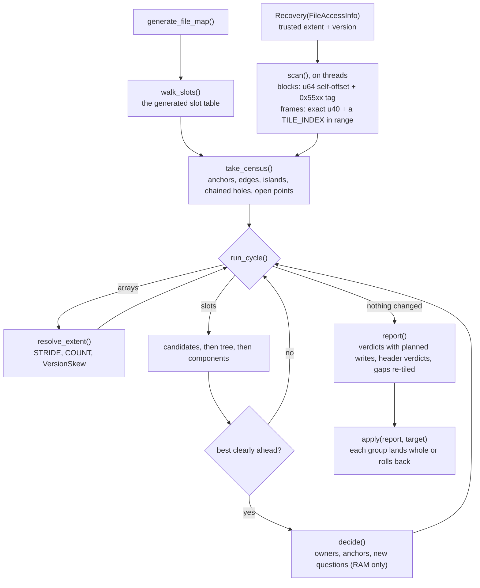
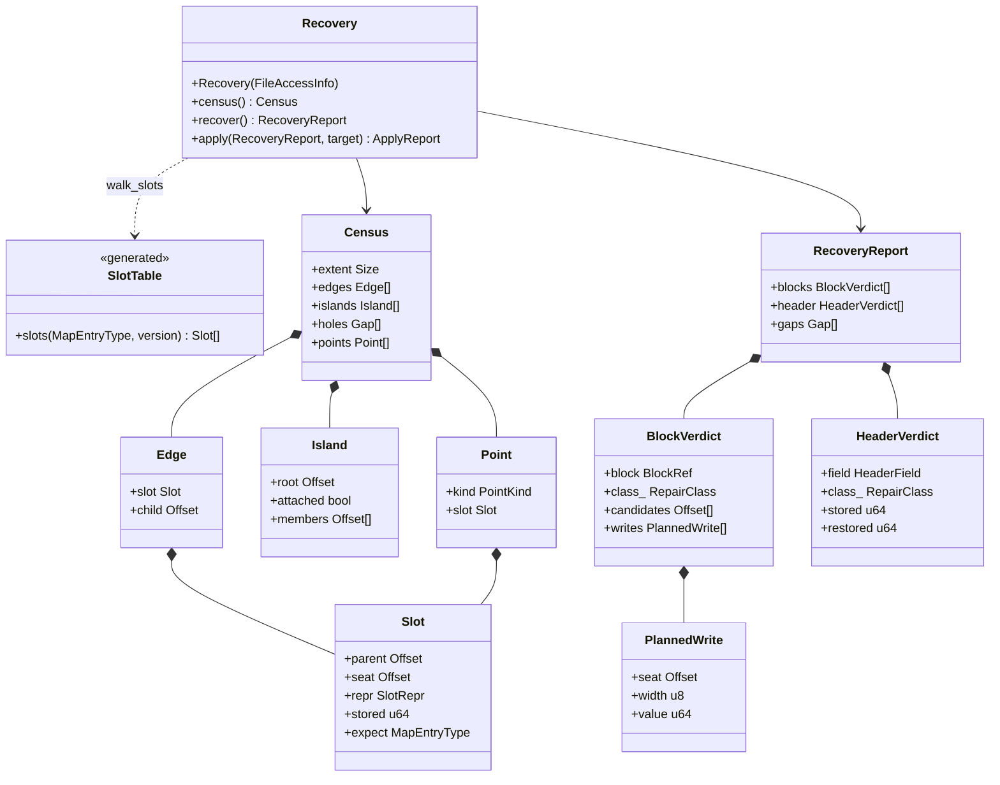

# The recovery rebuild: the census engine (RB-0 to RB-9)

> **Record.** Written 2026-09-28 in MIGRATION.md at the repository root; moved here on
> 2026-11-24 when `development/` replaced the root planning documents (git history
> keeps the originals; the last commit that holds them is 005347e). Kept as written,
> with local paths, sibling-checkout paths and a quotation restated for a public
> repository. Open items are tracked in [WBS.md](../WBS.md) under the same IDs; their
> boxes here read `(open: WBS.md)`. Dated records keep the names they had (Iris-Codec
> is now Iris-Slide).

**The engine below was removed on 2026-09-28**, uncommitted on top of `2967b09`,
so that it can be rebuilt on FastFHIR's census → branch-solver → transactional-apply
design (FastFHIR's `cap-api-surface` branch, commits `713d4f8` · `8ebcb52` · `0937653`;
FastFHIR's `recovery_algorithm_handoff.md`). The old engine can be recovered with
`git show 2967b09:src/IFE_Recovery.cpp`.

| Removed | Kept |
|---|---|
| `include/IFE_Recovery.hpp`, `src/IFE_Recovery.cpp` (2 253 lines) | `generate_file_map` and the file-map types (`FileMap`, `FileMapEntry`, `MapEntryType`, `Gap`/`GapClass`, `ProducerFailure`) |
| `Recovery`, `recover_file_structure`, `BlockRef`, `BlockVerdict`, `RepairClass`, `RecoveryReport` | `readable_entries` and `tile_frame_error` (`include/IFE_Primitives.hpp`) |
| `ife_recovery_tests`, `ife_recovery_bench_tests`, `ife_damage_sweep_tests` | the two-witness model and the paid-for rules (CLAUDE.md "Recovery") |

What is missing until the rebuild lands:
- **Any way to reopen a file `abstract_file_structure` refuses.** The census (RB-3) says
  what is damaged; deciding and writing repairs is RB-5 through RB-7.

The RC-* work orders below describe the removed engine. They stay as the record of
what it learned, and each lesson must reappear as a test of the census engine.

## The plan (RB-0 … RB-9)

The target is FastFHIR's design (`recovery_algorithm_handoff.md` §1–§9), rebuilt
for IFE's bytes. Its eight rules carry over unchanged:
- nothing is written until the end;
- a proposed value is never evidence;
- each witness is compared with the value it should encode, never with another witness;
- hard constraints eliminate a candidate; everything else only ranks;
- a match is admitted only where coincidence is improbable;
- the unit of decision is a branch;
- zero wrong writes;
- the result is deterministic.

### Where IFE differs from FastFHIR

| | FastFHIR | IFE | consequence |
|---|---|---|---|
| file size | MBs | GBs, almost all compressed pixel data | `apply` cannot copy the file into RAM (OD-R1); the byte scan runs on threads |
| references | 8/10-byte slots, relative codes | 14 block slots and 2 array-entry slots, all absolute u64 (`points_to` in `spec/ife_fields.json`); tile entries (u40 OFFSET + u24 SIZE); nested attribute values (u64 offsets inside ATTRIBUTE_BYTES, seated by ATTRIBUTE_SIZES) | three slot representations |
| headerless children | none | tile streams. The entry's SIZE is their only extent witness; an optional frame adds a u40 self-offset and an exact TILE_INDEX | frames are anchors of their own kind (RB-6) |
| layout | one per build | version-aware (EXTENSION_MAJOR/MINOR at the root) | the version is decided first, with the extent |
| root | FF_HEADER; STREAM_SIZE checked against the checksum footer | FILE_HEADER: MAGIC, RECOVERY, version, FILE_SIZE checked against the file's size; no footer (RC-5) | header verdicts per field (RB-4) |
| block order | parent order ≈ offset order | completion order: the codec claims tiles from many threads | FastFHIR's REC-23 bracket rule stays out |
| density, one parent per block | measured on Synthea | both hold on every writer measured at the reader's own version (RB-0). A newer file read by an older reader has gaps by design: appended fields make its blocks longer than the reader knows (`GapClass::VersionSkew`) | density ranks only where extents are exact (OD-R2); OD-R3 |

**False anchors in pixel data** (RB-0 (d), on proxy JPEG tiles). A frame's
self-offset is 40 bits: an 8 GiB slide holds 0.027 positions whose u40 reads
exactly as their own address, 0.96 within one bit and 17 within two. A u64 block
self-offset with a 0x55 tag byte gives under 10⁻⁷ even at two bits. So a frame
is an anchor only at distance 0 **and** with a plausible TILE_INDEX and
Z_PLANES. FastFHIR's `SELF_RADIUS = 2` applies to blocks, never to frames.

### Shape

**One graph walk.** `generate_file_map` and the census enumerate references
with the same `walk_slots` over a generated slot table (RB-2). This replaces the
removed engine's seven hand-written enumerators and `generate_file_map`'s own
walker. The census adds the byte scan; the map does not, so a clean-file map
stays proportional to the number of blocks, never to file size.

### Work orders

In order, each ending at its gate. RB-1 may run beside RB-0. Every new test is
registered in both `tests/tests.cmake` and `tests/tests.bzl`, and every gate
includes the ASan build (`cmake --build --preset asan && ctest --preset asan`).

- [x] **RB-0 — Measure the premises.** ✅ 2026-09-28, except (d) on real tiles.
  The probes were scratch programs, not committed (the repository stays small;
  RB-8 decides whether a threaded fixture helper lands). To rebuild one: a
  Builder slide of 3 layers (10×10, 20×20, 40×40 = 2 100 tiles, 5 % null,
  200–4 000 B streams), workers taking tiles in grid order as the codec's do,
  frames on and off, one image, 20 attributes, a 3 000 B ICC profile; then
  intervals from `generate_file_map` plus each tile's frame.

  | file | (a) gaps / overlaps | (b) shared targets | (c) framed SIZE = next start − anchor | tile offsets ascending |
  |---|---|---|---|---|
  | `cipher_iris`, `v1_0_witness`, `v1_1_witness` | 0 / 0 | 0 | 3/3, —, 3/3 | 2/2, 83/83, 2/2 |
  | Builder, 1 thread, frames on / off | 0 / 0 | 0 | 2 000/2 000, — | 1 999/1 999 |
  | Builder, 8 threads, frames on / off | 0 / 0 | 0 | 1 988/1 988, — | 1 139/1 987, 1 016/1 987 |

  - **Density and one parent hold on every writer measured.** Read, not run:
    the pre-Builder encoder is dense too. It bump-claims from the header's end,
    and `RESERVE_METADATA` claims exactly the METADATA block written into it
    later. No Iris-Codec (now Iris-Slide) path edits a file in place (`FILE_REVISION` is passed
    through, never incremented), so OD-R4 has no writer today.
  - **Order is not a witness** (57 % ascending at 8 threads), as measured
    2026-09-09; the single-threaded corpus reads 100 % and would mislead.
  - **(d) False anchors** — expected counts per slide, from 2 000 PIL-encoded
    JPEG tiles of synthetic tissue (q80, 14.9 MB; a **proxy**) and as many
    uniform bytes:

    | 8 GiB slide | exact | ≤ 1 bit | ≤ 2 bits |
    |---|---|---|---|
    | frame u40 self-offset, JPEG / uniform | 0.027 / 0.008 | 0.96 / 0.32 | 17 / 6.4 |
    | + TILE_INDEX < 200 000 and Z_PLANES ≤ 16, JPEG | < 10⁻⁷ | 0.0008 | 0.028 |
    | block u64 self-offset + a 0x55 tag byte, JPEG | < 10⁻⁷ | < 10⁻⁷ | < 10⁻⁷ |

    JPEG is 3–5× worse than the uniform arithmetic. A bare frame match is
    unsafe even when exact, so a frame is an anchor only at distance 0 **with**
    a plausible TILE_INDEX and Z_PLANES, and a tile candidate must match its
    slot's index exactly. Blocks keep `SELF_RADIUS = 2`: 2·10⁻⁷ even at
    64 GiB. **Still open:** the same measurement on a real slide's JPEG and
    AVIF tiles.
  - **Density is not a rule** (decided 2026-09-28, OD-R2). RB-0 only measured
    files at the reader's own version. A reader computes a block's extent from
    the fields it knows, so in a newer file every BLOCK-shaped type that gained
    fields ends later than the reader thinks. Those gaps are there by design.
    Arrays (stride on disk) and byte arrays (stamped count) do not skew, and
    block **starts** never do (VALIDATION is at offset 0). The file's version is
    in its header, so the reader knows which case it is in.
  - **Recommendation for OD-R3**, which the maintainer decides: one parent held
    everywhere, so H5 as a hard constraint.
- [x] **RB-1 — Restore the read-path damage sweep, without recovery.** ✅ 2026-09-28.
  `ife_damage_sweep_tests` (CMake + Bazel) flips every bit of the three corpus
  files and of a Builder-written slide (frames, a Z-stacked layer, a null tile,
  an image, attributes, ICC), one at a time, as FastFHIR's
  `census_single_flip_sweep` does: 43 216 flips, 0.6 s, 6.8 s under ASan.
  Red checks: `readable_entries` trusting COUNT → ASan heap-buffer-overflow in
  `generate_file_map`; the walk's tile bounds removed → the sweep crashes
  (SIGBUS). **Found and fixed:** 212 flips validated but the abstraction
  refused them — `validate_file_structure` never sliced the annotation groups.
  Both paths now share `walk_annotation_groups` (as they share
  `walk_tile_entries`), and the sweep asserts that a file that validates can
  be read (red: removing the call fails it).
- [x] **RB-2 — The generated reference table.** ✅ 2026-09-28.
  `Abstraction::FieldInfo` (`IFE_Recovery.hpp`) mirrors FastFHIR's
  `FF_FieldInfo`, reference fields only: `name`, `field_offset`,
  `child_recovery`, `nullable`, `in_entry`, `since`.
  `reference_fields_view(owner)` is generated into `IFE_Map.hpp` from the
  spec's `points_to`, as an exhaustive switch with no `default`: 16 edges, 14
  in block headers and 2 in array entries. `field_offset` counts from the
  block's start; an entry field names entry 0's copy, and entry i's is
  i × STRIDE further on. The tile entry's u40 OFFSET and nested attribute
  values are not `points_to` edges and stay hand-read (the spec is unchanged),
  as FastFHIR decodes its relative codes by hand.
  **Test** (`ife_runtime_tests`, `test_reference_fields_name_every_edge`,
  which now takes all three corpus files on Bazel too):
  - a walk driven only by the table, over each corpus file, finds both
    witnesses holding on every edge;
  - it reaches only blocks `generate_file_map` finds, and misses only tile
    streams and nested attribute structures;
  - the corpus exercises all 16 fields.

  Red: counting entry fields from the entry, or dropping the nullable fields,
  each fails it.
  **Gate:** `--check` clean; the wire witness is unchanged; 23/23 normal and
  ASan.
- [x] **RB-3 — One walk, and the census.** ✅ 2026-09-28. FastFHIR's census
  ported (`FF_Recovery.cpp` "PHASE 1" → `src/IFE_Recovery.cpp`, 822 lines, the
  same order and names: `take_census`, `chain_hole`, `next_block_after`,
  `derive`, `read_slots`, `settle`/`judge`, `children`, `attached`, `ask`,
  `census()`, `scan()`, `find_gaps()`), public types in `include/IFE_Recovery.hpp`.
  - **One walk.** `slots_of()` (`IFE_Primitives.hpp`) is the one reading of a
    block's references; `generate_file_map` is rewritten on it and matches the
    old implementation on all 38 603 maps (3 clean + every single-bit flip of
    the corpus). Generated for it: `blocks::with_block(tag, …)` (the typed
    handle for a run-time tag) and `entry_size_at(version)`.
  - **Where IFE's wire differs** (each in the code at the point it differs):
    a tile stream has no self-offset, so its witnesses are its placement (it
    starts inside nothing, crosses nothing, meets a neighbour) and its frame; a
    frame that took a flip leaves a frame-wide hole; nested attribute values may
    share (exempt from H5); IFE's growing blocks are single, so one block's run
    in a newer file is skew (FastFHIR needs two). The array stride is the one
    the file's version writes.
  - **Tests** (`ife_recovery_tests`, CMake + Bazel, FastFHIR's own shape):
    `check_clean_census` over the corpus and the Builder slide (framed and
    not); a newer writer's skew and its same-version control; FastFHIR's
    `census_single_flip_sweep` — 47 744 flips, every point explained, every
    damaged link opened. 1 s; 31 s under ASan.
  - **Red:** no H5 contest → 464 damaged slots left closed; no lost-frame rule
    → 120–160 damaged frames left closed per framed fixture; FastFHIR's
    two-instance skew rule → the skew reads as holes.
- (open: WBS.md) **RB-4 — The header and the trusted extent.** The version and the extent
  are decided first. Each header field gets a verdict:
  - MAGIC and RECOVERY are constants, restored only when enough blocks show
    the bytes are an Iris file;
  - EXTENSION_MAJOR/MINOR must be one of the known versions;
  - FILE_SIZE must equal the file's size;
  - FILE_REVISION has no witness, so it is reported and never written;
  - TILE_TABLE_OFFSET and METADATA_OFFSET are ordinary census slots.

  **Tests:** the removed root cases (magic within the flip budget; beyond it,
  and `NotAnIrisFile` writes nothing); every single flip in the header bytes.
- (open: WBS.md) **RB-5 — The solver, for blocks.**
  - The cycle: candidates → significance radius → tree → components → accept →
    decide.
  - Arrays go through `derive` (STRIDE, COUNT, VersionSkew).
  - **Tests carried from the removed suite:**
    - one witness damaged per class;
    - both witnesses lost, recovered from the predecessor's extent;
    - a wrong-type reading (FastFHIR's F01 shape: METADATA's slot flipped onto
      an innocent block);
    - a contended repoint is never confident;
    - generational holes recover from the root;
    - damage is never silent;
    - wire offsets never wrap a bounds check.
- (open: WBS.md) **RB-6 — Tile streams.**
  - A tile entry's candidates are framed streams whose TILE_INDEX matches
    exactly.
  - A lost TILE_OFFSETS array is rebuilt from frames: the anchor; SIZE = the
    next start − the anchor (a start is exact under any version, OD-R2); the
    index = TILE_INDEX. Z_PLANES may not exceed its layer's.
  - Unframed streams are reported, never repointed.
  - **Tests:**
    - a surviving frame rebuilds its entry;
    - unframed corruption is reported;
    - a flipped entry never names another tile's stream.
- (open: WBS.md) **RB-7 — Report and apply.**
  - Each verdict carries its planned writes.
  - `apply` writes into the target OD-R1 chooses: each group lands whole, is
    read back, or rolls back.
  - **Tests:**
    - an out-of-range write aborts;
    - recover → apply → recover reports everything Intact;
    - Ambiguous and Unrecovered verdicts write nothing.
- (open: WBS.md) **RB-8 — Bench and calibration.**
  - The bits→percent curve on the RB-0 fixture, counted in anchored units,
    with misattachment asserted zero and the clean control unchanged.
  - FastFHIR's constants (MAX_CHANCE 1/64, ACCEPT_ABS 32, ACCEPT_MARGIN 64,
    K_BEST 256, MAX_COMPONENT 8) start as priors and are re-measured here.
- (open: WBS.md) **RB-9 — Docs.**
  - `architecture.md` §3–§5 rewritten for the census, with the diagrams above.
  - CLAUDE.md "Recovery" keeps the paid-for rules and drops the removed
    engine's function names.
  - README "Recovering a Damaged File" returns, with an example the README
    gate compiles.

### The removed engine's refinements, and where each lives now

| IFE refinement | in the census design | kept by |
|---|---|---|
| root repair (`RootRepaired`) | header verdicts (FastFHIR §2.5) | RB-4 |
| tag consensus (RC-8) | ranking whole branches over candidate types (FastFHIR §3 F01, §7) | RB-5 wrong-type test |
| hole self-signature, band expansion | hole chaining, and one significance radius per slot (FastFHIR §3, §7.1) | RB-5 lost-block test |
| one cost-ranked decision per edge | the tree and its components | RB-5 contended repoint |
| TILE_INDEX matched exactly | a hard constraint on tile candidates | RB-6 |
| in-place apply with rollback | per-group writes with rollback, into OD-R1's target | RB-7 |
| geometry-bounded array walks (`readable_entries`) | `derive` | RB-5 |

### Open decisions (for the maintainer; the default lets work proceed)

| id | question | default |
|---|---|---|
| OD-R1 | Where does `apply` write? FastFHIR copies the stream into a `std::vector`; a slide is GBs. | Into a writable mapping the caller supplies (a clone or copy of the file). Recovery never writes the source. |
| OD-R2 | Density: a premise or a rule? | **Closed 2026-09-28: density is not a rule.** A newer file has gaps, by design, wherever an older reader under-counts a block that gained fields. Exact adjacency is used only after a predecessor whose extent is exact: a same-or-older-version file, or an array, byte array or stream. Otherwise its computed end is a lower bound, as FastFHIR's H3 treats it. |
| OD-R3 | One parent per block and per stream (H5). The spec does not forbid two tile entries sharing a stream, such as a deduplicated blank tile. | RB-0 found no sharing. **Nested attribute values are exempt:** the format lets two share one structure, and `ife_runtime_tests` (`test_shared_nested_structures_are_validated_once`) requires readers to accept it. Default: H5 is a hard constraint on the 16 declared edges and on tile entries, plus a "shall not" for shared streams in the 1.1 draft. |
| OD-R4 | FILE_REVISION implies in-place edits, which leave superseded blocks with valid witnesses. | Treat them as orphans; RB-5 adds a test that a superseded block is never attached. Revisit if revision is not a supported write mode. |
| OD-R5 | The public shape. | FastFHIR's: `Recovery(const FileAccessInfo&)` with `census` / `recover` / `apply`, in `IFE_Recovery.hpp` (advanced tier). `RepairClass` becomes FastFHIR's seven: `HoleCorroborated` goes (lost blocks become anchors), and `RootRepaired` goes (the root gets header verdicts). |
