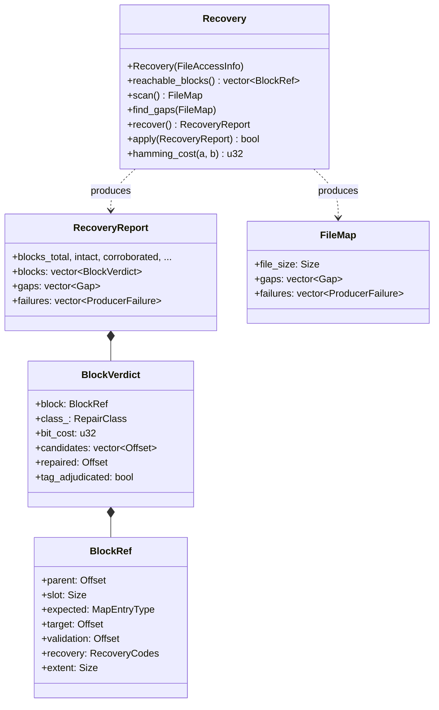
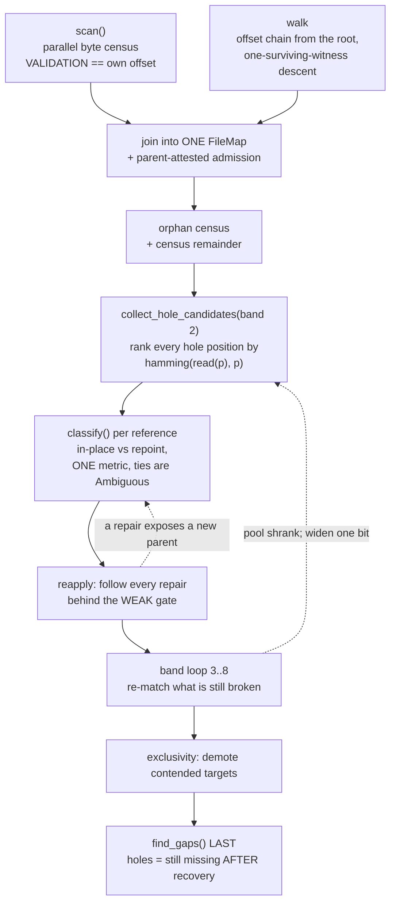
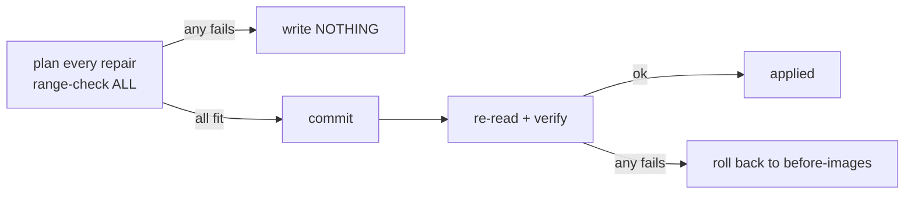

# The removed recovery engine: types, pipeline and apply()

> **Record.** Written before 2026-09-28 in architecture.md at the repository root; moved here on
> 2026-11-24 when `development/` replaced the root planning documents (git history
> keeps the originals; the last commit that holds them is 005347e). Kept as written,
> with local paths, sibling-checkout paths and a quotation restated for a public
> repository. Open items are tracked in [WBS.md](../WBS.md) under the same IDs; their
> boxes here read `(open: WBS.md)`. Dated records keep the names they had (Iris-Codec
> is now Iris-Slide).

## 3. Recovery: the types

`BlockRef` is the atom: one parent→child edge carrying **both witnesses** plus
the compiled expectation. `BlockVerdict` is that edge plus what recovery
decided. Everything the engine reports is a list of verdicts — there is no
side channel.

### The verdict classes

| Class | Means | `apply()` writes |
|---|---|---|
| `Intact` | both witnesses agreed | nothing |
| `Corroborated` | parent's offset was damaged; a surviving orphan is the child | the parent slot |
| `HoleCorroborated` | same, but the child is a ranked **hole** position — the pointer is restored, the bytes are still destroyed | the parent slot |
| `TagRepaired` | the child's `RECOVERY` tag was the damaged half | the child's tag — **only** if the wire tag is implausible, or coherence adjudicated it |
| `PositionRepaired` | the child's `VALIDATION` was the damaged half | the child's VALIDATION |
| `ExtentDerived` | an array's claimed extent overruns the next entry | the array's COUNT |
| `Ambiguous` | two live readings at equal cost | **nothing, ever** |
| `Unrecovered` | nothing within the flip budget | **nothing, ever** |

`Ambiguous` and `Unrecovered` are reported *because the engine declined to
choose*. Writing them would convert a declared uncertainty into a silent one.

---

## 4. Recovery: the pipeline

Two producers fail in **opposite** directions, which is why both run:

| producer | finds | cannot see |
|---|---|---|
| the offset-chain walk | broken references — a slot whose target does not resolve | a block nothing points at |
| the byte scan | orphans — self-consistent blocks nothing references | a block whose `VALIDATION` is damaged |

Two properties of that picture carry the design:

* **the byte sweep is outside the loop** (built once) and the loop iterates
  **references**, of which there are few. Sweeping bytes and asking "does any
  reference want this?" inverts the cheap and expensive sides.
* **the arrow back from *reapply* into *classify*** is the generational
  cascade. A repaired block is now a *parent* whose outgoing references have
  never been looked at — the walk could not reach it, the scan could not
  identify it. Cut that arrow and every chain of losses stops at its first
  repair.

### Where each step lives

`src/IFE_Recovery.cpp` reads top-to-bottom from `recover()`. Line numbers are
a starting point, not a contract — grep the name if one has drifted.

| Line | What |
|---|---|
| `87` | `read_witnesses` — loads the child's VALIDATION + tag |
| `214` | `enumerate_tile_offsets` — the one headerless edge; reads the frame |
| `426` | `enumerate_one_level` — dispatches on block SHAPE |
| `490` | `drive_walk` — the offset-chain walk |
| `646` | `Recovery::Recovery` — binds base/size; never dereferences a header |
| `664` | `scan()` — the parallel byte census |
| `804` | `find_gaps()` — the tiling; Hole / VersionSkew / Trailing |
| `892` | `HoleCandidate` + `collect_hole_candidates` — the ranked pool |
| `1016` | `batch_passes` — the two gate strengths |
| `1113` | `frame_tile_index` / `entry_tile_index` — the identity witness |
| `1145` | `classify()` — the per-reference verdict |
| `1472` | `recover()` — the pipeline above |
| `2207` | `apply()` — the only mutating path |

---

## 5. `apply()` — the only mutating path

Plan every repair and range-check it **before touching a byte**, commit, re-read
each committed run, and roll the whole report back to its before-images if any
write fails to verify. IFE repairs the caller's own buffer, so those
before-images play the role of a working copy.

A repair class that rewrites a **type** is far more dangerous than one that
rewrites a **position**: a wrong position fails loudly at the next witness
check, while a wrong type silently relabels real data and removes that block's
subtree from the census permanently. That is why `TagRepaired` is gated.

---
