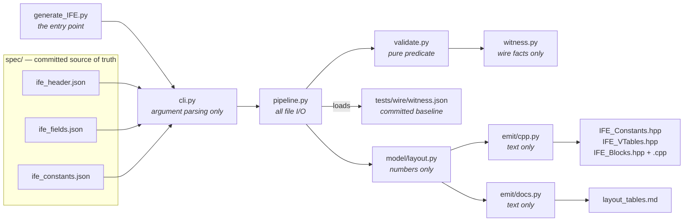

# `generator/` — the IFE code generator

Turns the committed spec JSON
(`spec/ife_header.json`, `spec/ife_fields.json`, `spec/ife_constants.json`)
into the C++ that Iris-File-Extension compiles — and the derived layout tables
the HTML and PDF specification document renders. Standard library only.

Run it through `generate_IFE.py` at the repository root, its one entry point,
from any working directory:

```bash
python3 generate_IFE.py                   # writes build/generated_source/ + build/generated_docs/
python3 generate_IFE.py --out-dir DIR     # write the C++ elsewhere
python3 generate_IFE.py --validate        # conflicts, dangling references, wire-witness drift
python3 generate_IFE.py --check           # CI: exit 1 on stale witness or banner-hash parity break
```

The output is a build product, never written into the source tree or
committed (decided 2026-11-25, R-7): CMake runs the generator at every
configure into `<binary dir>/generated_source/` and `generated_docs/`, Bazel's
genrule into `$(RULEDIR)`, and each release attaches the generated C++ as
`IrisFileExtension-<version>-generated-source.tar.gz` for consumers who do not
run Python. A copy in the source tree would be a second, drift-prone copy of
what the JSON already states, shared and overwritten by every build directory
of the checkout.

`--validate` runs automatically before every generation, so a broken spec
never reaches the emitters. It also recomputes the wire witness and fails on
drift against the committed baseline in `tests/wire/witness.json` — the
append-only gate (see below) — and prints a non-fatal note when the spec has
grown facts the baseline has not recorded yet. `--check` turns that note into
a failure: the committed evidence must be current for the drift gate to mean
anything.

## Output contract

| Output | Contract |
|--------|----------|
| `spec/*.json` | **Source of truth. Committed.** Identity, fields, types, values. |
| `tests/wire/witness.json` | **Append-only evidence. Committed.** The wire witness — every fact that reaches the stream, never C++ text. `--validate` fails if a shipped fact changed or disappeared; additions pass silently. Refresh only after a reviewed wire change: see `tests/wire/README.md`. |
| `generated_source/` | **A build product.** The C++ layer, listed below. Written at every CMake configure into the binary directory. |
| `generated_docs/` | **A build product.** The specification's generated half, listed below. |

The outputs are registered in one place — `pipeline.py::_render` — and
`--check` verifies whatever that map contains, so adding an artifact never
means remembering to extend the drift gate.

### The C++ layer (`generated_source/`)

| File | Content |
|------|---------|
| `IFE_Blocks.hpp` + `.cpp` | The whole block layer: `Iris::File::constants` (enumerations and sentinels), each block's derived offset and size tables, the typed block handles with their accessors, `points_to` navigation and structural validators, the `*CreateInfo` writer payloads, and the `Iris::File::Serialization` consumer namespace. One header, since the split cost consumers an include list and bought nothing. |
| `IFE_Map.hpp` | Wire tag to `MapEntryType`, and each block's reference fields. |
| `IFE_Validation.hpp` + `.cpp` | The conformance layer: the JSON's normative `shall`/`should` clauses compiled into an attachable set of `ValidationHooks`. Its own target; never a link-time dependency of the library. |

Nothing here is exported from the shared library: `Iris::File::blocks` and
`Iris::File::constants` carry no export marking, and a test fails the build if
any becomes visible. The layer is field arithmetic, which inlines better than
it calls across a library boundary, and it must stay free to change whenever
the schema does, which an exported symbol cannot. The stable, exported API is
the semantic layer: `validate_file_structure`, `abstract_file_structure`,
`generate_file_map` and the `Abstraction::` structs.

### The specification's tables (`generated_docs/`)

| Path | Content |
|------|---------|
| `layout/<BLOCK>.adoc` | One block's header table: field, type, derived offset, size, optionality, description. |
| `layout/<BLOCK>_entry.adoc` | That block's array-entry table, where it has one. |
| `layout/primitive_<NAME>.adoc` | A shared prefix every derived block carries. |
| `constants/<GROUP>.adoc` | One enumeration, or the statically defined values. |
| `attributes.adoc`, `provenance.adoc`, `revision_history.adoc` | The document header; the specification version, status and the generator version that rendered it; the revision history. |

One file per item, as the Vulkan specification is assembled: `spec/ife_spec.adoc`
includes exactly what it needs with Asciidoctor's native `include::`, so
moving a section never drags an unrelated table along, and no preprocessor or
bespoke anchor syntax exists anywhere in the pipeline. `spec/build_document.sh
[output-dir] [docs-dir]` regenerates the tables and renders the document
(`asciidoctor`, and `asciidoctor-pdf` for the PDF, Ruby >= 3.2).

`--check` is **parity, not byte-equality** (XP-2): every generated file's
banner carries the wire-witness sha256, and `--check` compares that against a
fresh computation. A comment edit in an emitter — a version bump, a copyright
year — no longer flags as drift; only a file produced from a different spec
does. Content beyond the banner is unwitnessed by design: the build and the
corpus oracle own that ground. (`attributes.adoc` is the one banner-less
file: it is the AsciiDoc document header, which cannot carry a comment
block.)

Nothing generated is permanent — but the *vtable layout* is, which is why
the JSON is versioned append-only.

## CLI contract (final)

| Flag | Default | Meaning |
|------|---------|---------|
| `-d`, `--directory` | the repository root | Directory the relative `--schema-dir`, `--out-dir` and `--docs-dir` resolve against. Absolute paths are used as given |
| `--schema-dir` | `spec/` | Directory holding `ife_header.json` + `ife_fields.json` + `ife_constants.json` |
| `--out-dir` | `build/generated_source/` | Where generated C++ is written; where `cmake -B build` writes it |
| `--docs-dir` | `build/generated_docs/` | Where generated documentation is written |
| `--validate` | — | Check the documents for conflicts, dangling references, and drift against the committed wire witness (`tests/wire/witness.json`), emit nothing (exit 1 on any). Warns — non-fatally — when the spec has unrecorded additions |
| `--check` | — | Fail (exit 1) if any generated file's banner witness hash mismatches the current spec (parity, not byte-equality) or the committed witness is stale |

CMakeLists.txt, `tests/tests.cmake`, the Bazel genrules,
`spec/build_document.sh` and CI invoke exactly this interface; changing flags
requires updating them in the same change. `-d` defaults to the repository
holding the package, so `generate_IFE.py` runs by path from any directory;
the Bazel genrules pass `-d .`, the execution root their paths are relative
to. `tests/generator/test_directory_flag.py` checks both.

## Module map



| Module | Role |
|--------|------|
| `cli.py` | Argument parsing, called by `generate_IFE.py`; contract above. |
| `pipeline.py` | Stage orchestration: load JSON → validate → derive → emit → write or `--check`. The only module that touches the filesystem; no code generation lives here. |
| `validate.py` | Consistency checks across the documents, including the append-only gate: the current tree's witness against the committed baseline. Returns (problems, warnings); raises nothing; reads no files. Warnings are a stale witness baseline — `--check` promotes them to a failure. |
| `witness.py` | The wire witness: captures only what reaches the stream (block tags, per-version field tuples, enum values, named constants), derived through `model/layout.py`. Reads no files. |
| `model/layout.py` | Layout derivation — the single implementation of the offset/size rules; offsets are never read from the JSON. |
| `emit/cpp.py` | C++ emission: `IFE_Constants.hpp` (enums + sentinels), `IFE_VTables.hpp` (vtables), `IFE_Blocks.hpp`/`.cpp` (handles, readers, validators). |
| `emit/docs.py` | Markdown emission: derived layout tables (first cut of the doc emitter; full spec assembly comes with the document pipeline). |

The boundary in that diagram is load-bearing: `model/` never produces text,
`emit/` never does arithmetic on a byte offset, `validate.py` never touches the
filesystem. Arithmetic found in `emit/` is in the wrong file. The witness
baseline is read by `pipeline.py` — the only module that touches the
filesystem — and handed to `validate.py` as data, so the boundary holds.

CMake runs `generate_IFE.py` at every configure, with `spec/`, `generator/`,
`generate_IFE.py` and the witness as configure dependencies; writes happen only
where content changed, so an unchanged spec rebuilds nothing.

## Contract

* Output must be byte-stable (stable ordering, no timestamps): the same
  layout always yields the same bytes, which is what makes regeneration
  deterministic and the banner witness hash meaningful. `--check` verifies
  parity against that hash, not character equality. The determinism is
  tested, not assumed — `tests/generator/test_determinism.py` runs the
  generator twice into separate trees and compares (ctest
  `ife_generator_determinism`; CI adds `PYTHONHASHSEED=0/1`, where dict/set
  iteration order is where non-determinism would enter).
* Never hand-edit `generated_source/` or `generated_docs/`; fix the JSON
  or the emitter and regenerate.
* A file the current spec no longer produces is an **orphan**: `--check`
  fails on it and regeneration removes it, so a renamed block cannot leave its
  old table for the narrative to keep including.
* The vtable layouts emitted are wire constants: see `spec/README.md` for the
  append-only versioning rules.
